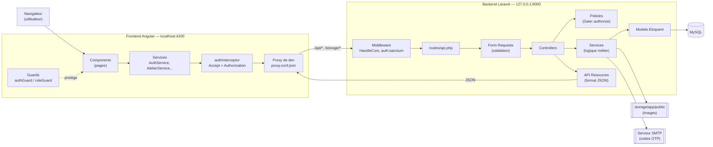
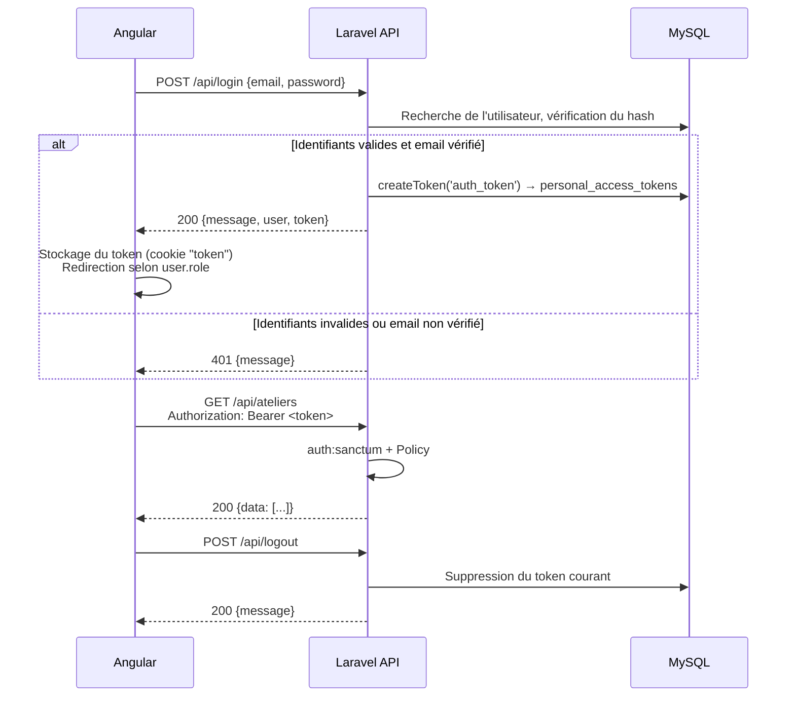
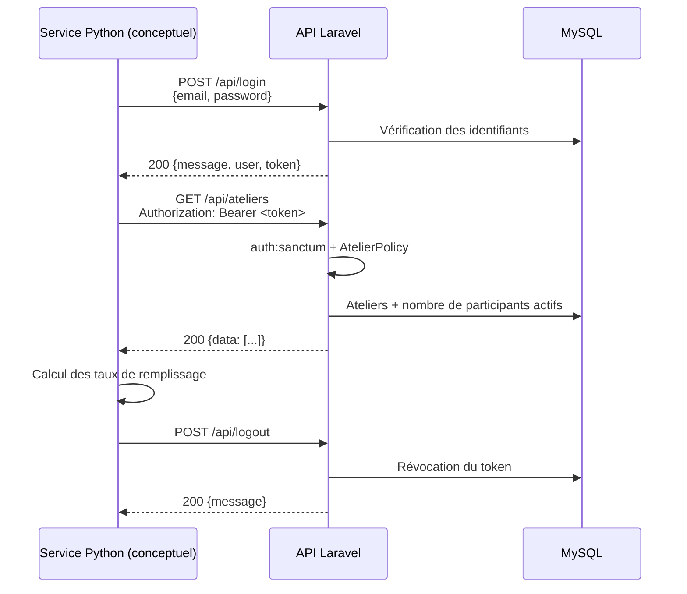
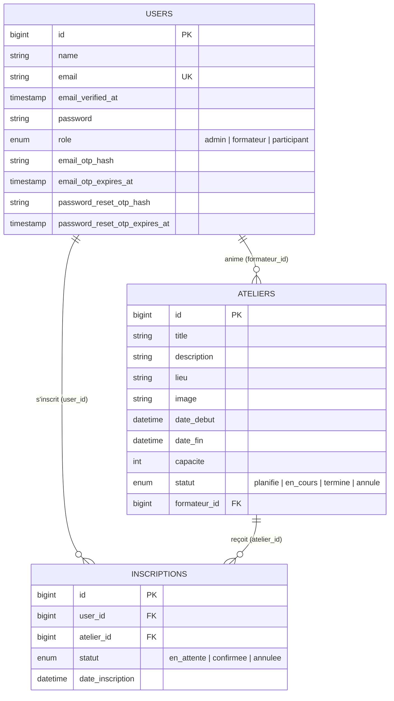
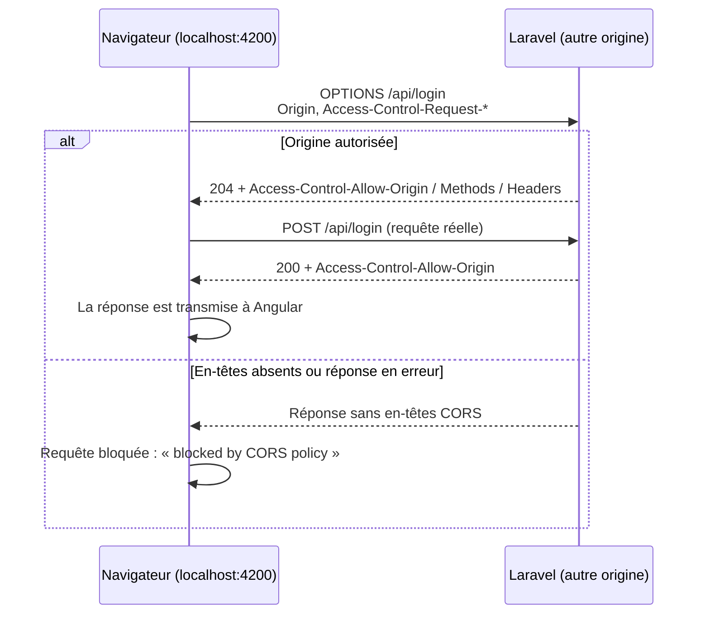

# Formation Platform

Plateforme web de gestion d'ateliers de formation, composée d'une **API REST Laravel** (backend) et d'une **application Angular** (frontend).

Dépôt GitHub : [github.com/GhaziRabeh/formation-platform](https://github.com/GhaziRabeh/formation-platform)

---

> ## 1. Note importante sur la livraison
>
> **⚠️ À lire en priorité.**
>
> Je tiens d'abord à présenter mes excuses pour ne pas avoir terminé ce test technique dans le délai initialement prévu.
>
> Pendant le développement, j'ai rencontré un problème technique important dans la communication entre le frontend Angular et l'API Laravel : les requêtes envoyées par le navigateur étaient bloquées par la politique **CORS** (*Cross-Origin Resource Sharing*). Le problème portait principalement sur la configuration des **origines autorisées** et sur la gestion des **requêtes préliminaires `OPTIONS`** (*preflight*) que le navigateur envoie avant les appels contenant les en-têtes `Authorization` ou `Content-Type: application/json`. Concrètement, la connexion échouait dans le navigateur et l'application ne pouvait pas communiquer avec l'API.
>
> Ce type d'erreur est difficile à diagnostiquer, car le message affiché par le navigateur (« blocked by CORS policy ») peut masquer une cause différente côté serveur. J'ai donc procédé par étapes : analyse des requêtes dans les outils de développement du navigateur, simulation des requêtes `OPTIONS` avec `curl`, journalisation temporaire des requêtes entrantes dans Laravel et lecture des journaux d'erreurs. Cette démarche a mis en évidence plusieurs causes cumulées, mais elle a demandé beaucoup plus de temps que prévu et a retardé la finalisation et la livraison du projet. J'assume pleinement la responsabilité de ce retard.
>
> **Le problème CORS est aujourd'hui résolu.** La communication entre Angular et Laravel fonctionne correctement, l'authentification est opérationnelle et les trois espaces (administrateur, formateur, participant) sont fonctionnels. Une version corrigée du projet a été poussée sur GitHub après la date limite initiale. Cette nouvelle livraison regroupe :
>
> - les corrections apportées (CORS, proxy Angular, gestion des erreurs d'authentification) ;
> - le code source complet du backend et du frontend ;
> - le MCD ([MCD_ateliers.pdf](MCD_ateliers.pdf)) ;
> - des données de démonstration générées par des seeders ;
> - la présente documentation technique.
>
> Le détail du problème, de la démarche de diagnostic et de la solution adoptée est présenté dans la [section 8 — Problème CORS et résolution](#8-problème-cors-et-résolution).
>
> Je vous remercie sincèrement pour votre compréhension et pour le temps consacré à l'évaluation de ce travail.

---

## Table des matières

1. [Note importante sur la livraison](#1-note-importante-sur-la-livraison)
2. [Présentation du projet](#2-présentation-du-projet)
3. [Architecture](#3-architecture)
4. [Installation](#4-installation)
5. [Justification des choix techniques](#5-justification-des-choix-techniques)
6. [Échange entre une API Python et Laravel](#6-échange-entre-une-api-python-et-laravel)
7. [Documentation complémentaire](#7-documentation-complémentaire)
8. [Problème CORS et résolution](#8-problème-cors-et-résolution)
9. [Conclusion](#9-conclusion)

---

## 2. Présentation du projet

### 2.1. Objectif

Formation Platform centralise l'organisation d'ateliers de formation : création et planification des ateliers par un administrateur, suivi des participants par les formateurs, et inscription en ligne des participants.

### 2.2. Problème adressé

Sans outil dédié, la gestion d'ateliers repose souvent sur des fichiers et des échanges d'emails : les places disponibles sont mal suivies, les inscriptions en double ne sont pas détectées et chaque intervenant n'a pas une vue claire de ce qui le concerne. L'application répond à ces points :

- une **source unique** pour les ateliers, les formateurs et les inscriptions ;
- un **contrôle automatique de la capacité** et des inscriptions en double ;
- des **espaces distincts par rôle**, chacun ne voyant que les données qui le concernent ;
- une **API REST** réutilisable par d'autres clients que le frontend Angular.

### 2.3. Types d'utilisateurs

| Rôle | Description |
|---|---|
| **Administrateur** (`admin`) | Gère l'ensemble des ateliers, consulte toutes les inscriptions et la liste des utilisateurs. |
| **Formateur** (`formateur`) | Consulte les ateliers qu'il anime et gère les inscriptions de ses ateliers. |
| **Participant** (`participant`) | Consulte le catalogue, s'inscrit aux ateliers et suit ses inscriptions. |

### 2.4. Fonctionnalités principales

**Authentification**
- Inscription avec choix du rôle `participant` ou `formateur` (le rôle `admin` ne peut pas être choisi à l'inscription).
- Vérification de l'adresse email par un code OTP à 6 chiffres envoyé par email (valable 10 minutes), avec possibilité de renvoyer le code.
- Connexion par email et mot de passe, refusée tant que l'email n'est pas vérifié.
- Mot de passe oublié : envoi d'un code OTP puis définition d'un nouveau mot de passe.
- Déconnexion avec révocation du token.

**Administrateur**
- Tableau de bord : nombre d'ateliers, de participants, de formateurs et d'inscriptions actives ; liste des 5 derniers ateliers.
- Création, modification et suppression d'ateliers (avec image facultative).
- Affectation d'un formateur à chaque atelier.
- Consultation des participants d'un atelier.
- Consultation de toutes les inscriptions, confirmation ou annulation.
- Liste des participants inscrits sur la plateforme.

**Formateur**
- Liste de ses ateliers avec statistiques et taux de remplissage.
- Liste des participants d'un atelier, confirmation ou annulation des inscriptions.

**Participant**
- Catalogue des ateliers planifiés et à venir, avec places restantes.
- Inscription à un atelier, consultation et annulation de ses inscriptions.

### 2.5. Technologies

| Couche | Technologie | Version (dépendances du projet) |
|---|---|---|
| Backend | PHP | `^8.1` |
| Backend | Laravel | `^10.0` (10.50 installée) |
| Authentification | Laravel Sanctum | `^3.2` |
| Base de données | MySQL | — |
| Frontend | Angular / Angular CLI | `^16.2` |
| Langage frontend | TypeScript | `~5.1.3` |
| Styles | Tailwind CSS | `^3.4.17` |
| Icônes | lucide-angular | `^1.0.0` |
| Stockage du token | ngx-cookie-service | `^16.1.0` |

### 2.6. État actuel du développement

- Toutes les fonctionnalités listées ci-dessus sont implémentées et fonctionnelles.
- Le problème CORS est résolu ; le frontend communique avec l'API via le proxy de développement Angular.
- Des seeders et factories génèrent un jeu de données de démonstration complet.
- Le build de production Angular (`ng build`) se termine sans erreur.
- Les tests automatisés se limitent pour l'instant aux tests d'exemple fournis par Laravel (voir [9.2](#92-limites-connues-et-pistes-damélioration)).

---

## 3. Architecture

### 3.1. Vue d'ensemble

Le projet est composé de deux applications indépendantes, réunies dans le même dépôt :

- **`frontend/`** : application Angular exécutée dans le navigateur. Elle gère l'interface, la navigation et l'état de session, et consomme l'API.
- **`backend/`** : API REST Laravel. Elle porte toute la logique métier, la validation, les autorisations et l'accès à la base MySQL.

Les deux applications communiquent exclusivement en **HTTP / JSON**. En développement, le navigateur appelle `http://localhost:4200/api/...` : le serveur de développement Angular transmet ces requêtes à Laravel sur `http://127.0.0.1:8000` grâce au fichier `proxy.conf.json`.



### 3.2. Rôle d'Angular (frontend)

Angular 16 est utilisé avec des **composants standalone** (sans `NgModule`) et des routes chargées à la demande (`loadComponent`). La configuration globale se trouve dans `src/app/app.config.ts` :

```typescript
export const appConfig: ApplicationConfig = {
  providers: [
    provideRouter(routes),
    provideHttpClient(
      withInterceptors([authInterceptor])
    ),
    CookieService
  ]
};
```

| Élément | Fichiers | Rôle |
|---|---|---|
| **Components (pages)** | `src/app/pages/**` | Écrans par rôle : `auth/`, `admin/`, `formateur/`, `participant/` |
| **Components partagés** | `src/app/shared/components/` | `SidebarComponent` (menu selon le rôle), `StatutBadgeComponent` (badge de statut) |
| **Services** | `src/app/core/services/` | `AuthService`, `AtelierService`, `InscriptionService`, `UserService` : centralisent les appels `HttpClient` |
| **Guards** | `src/app/core/guards/` | `authGuard` (token présent), `roleGuard` (rôle attendu par la route) |
| **Interceptor** | `src/app/interceptors/auth.interceptor.ts` | Ajoute `Accept: application/json` et `Authorization: Bearer <token>` à chaque requête |
| **Interfaces** | `frontend/types/` | Types TypeScript des données échangées (`User`, `Atelier`, `Inscription`...) |
| **Environnement** | `src/environments/environment.ts` | `apiUrl: '/api'` (URL relative, résolue par le proxy) |

### 3.3. Rôle de Laravel (backend)

Le backend suit une organisation en couches : chaque classe a une responsabilité unique.

| Couche | Emplacement | Rôle |
|---|---|---|
| **Routes** | `routes/api.php` | Déclarent les endpoints (préfixe `/api`) et appliquent `auth:sanctum` aux routes protégées |
| **Form Requests** | `app/Http/Requests/` | Valident les données entrantes avant d'atteindre le contrôleur (réponse `422` en cas d'erreur) |
| **Controllers** | `app/Http/Controllers/Api/` | Reçoivent la requête, vérifient l'autorisation, délèguent au service et renvoient la réponse JSON |
| **Policies** | `app/Policies/` | Règles d'autorisation par rôle et par propriétaire (`AtelierPolicy`, `InscriptionPolicy`, `UserPolicy`) |
| **Services** | `app/Services/` | Logique métier : inscription, capacité, statuts, upload d'images, envoi des OTP |
| **Models** | `app/Models/` | Modèles Eloquent `User`, `Atelier`, `Inscription` et leurs relations |
| **Resources** | `app/Http/Resources/` | Mise en forme des réponses JSON (`AtelierResource`, `InscriptionResource`, `UserResource`) |
| **Exceptions** | `app/Exceptions/` | Exceptions métier (`LoginException`, `RegisterException`...) et `Handler` qui les convertit en JSON |
| **Mail** | `app/Mail/` | `VerifyEmailOtpMail`, `PasswordResetOtpMail` |

Exemple du découpage contrôleur / policy / service (`AtelierController`) :

```php
// Create atelier
public function store(StoreAtelierRequest $request)
{
    Gate::authorize('create', Atelier::class);

    $atelier = $this->atelierService->create(
        $request->validated()
    );

    return (new AtelierResource($atelier))
        ->response()
        ->setStatusCode(201);
}
```

### 3.4. Déroulement d'une requête HTTP

1. Un composant appelle une méthode de service, par exemple `AtelierService.getAll()`.
2. Le service envoie `GET /api/ateliers` avec `HttpClient`.
3. `authInterceptor` ajoute les en-têtes `Accept: application/json` et `Authorization: Bearer <token>`.
4. Le serveur de développement Angular transmet la requête à `http://127.0.0.1:8000/api/ateliers`.
5. Laravel exécute les middlewares globaux (dont `HandleCors`), puis `auth:sanctum` identifie l'utilisateur à partir du token.
6. Le contrôleur vérifie l'autorisation via la policy, appelle le service, puis renvoie une `AtelierResource`.
7. La réponse JSON (`{ "data": [...] }`) revient au service Angular, qui extrait `data` et la transmet au composant.

### 3.5. Authentification

L'authentification repose sur les **tokens d'accès personnels de Laravel Sanctum** (authentification *stateless* par jeton *Bearer*).



- **Côté Laravel** : `LoginController` crée le token après validation par `LoginService` (mot de passe vérifié avec `Hash::check`, connexion refusée si `email_verified_at` est vide). Les routes protégées utilisent le middleware `auth:sanctum`. `LogoutService` supprime le token courant. Aucune durée d'expiration n'est configurée (`'expiration' => null` dans `config/sanctum.php`) : le token reste valide jusqu'à la déconnexion.
- **Côté Angular** : `AuthService` enregistre le token dans un cookie `token` (durée 1 jour, chemin `/`, `SameSite=Lax`) via `ngx-cookie-service`, et conserve l'utilisateur courant en mémoire. Après un rechargement de page, `roleGuard` récupère l'utilisateur avec `GET /api/user`.
- **Requêtes non authentifiées** : le `Handler` renvoie `401 {"message": "Unauthenticated."}` pour toute route `api/*`, au lieu de rediriger vers une route `login` inexistante.

### 3.6. Gestion des rôles

Le rôle est stocké dans la colonne `users.role` (`admin`, `formateur`, `participant`). Il est contrôlé à deux niveaux :

**Côté Laravel (contrôle de sécurité réel)** : chaque contrôleur appelle `Gate::authorize(...)`, qui s'appuie sur les policies découvertes automatiquement par Laravel. Un refus produit une réponse `403`.

```php
// AtelierPolicy
public function view(User $user, Atelier $atelier): bool
{
    return $user->isAdmin()
        || (
            $user->isFormateur()
            && $user->id === $atelier->formateur_id
        );
}
```

Le service adapte également les données renvoyées au rôle : `GET /api/ateliers` renvoie tous les ateliers à l'administrateur, uniquement ses ateliers au formateur, et uniquement les ateliers `planifie` à venir au participant.

**Côté Angular (confort de navigation)** : chaque groupe de routes déclare le rôle attendu, vérifié par `roleGuard`. Le guard évite d'afficher un écran inaccessible, mais ne remplace jamais le contrôle côté serveur.

```typescript
{
  path: 'admin',
  canActivate: [authGuard, roleGuard],
  data: { role: 'admin' },
  children: [ /* dashboard, ateliers, inscriptions, users */ ]
}
```

Après la connexion, l'utilisateur est redirigé selon son rôle : `/admin/dashboard`, `/formateur/mes-ateliers` ou `/participant/catalogue`.

### 3.7. Authentification de l'administrateur

L'administrateur utilise le **même mécanisme d'authentification** que les autres rôles (`POST /api/login`, token Sanctum). Ce qui le distingue, c'est la manière dont son compte est créé et l'accès à l'espace `/admin`.

**Aucune inscription publique en tant qu'administrateur**

Le formulaire d'inscription ne propose que les rôles `participant` et `formateur`, et l'API refuse le rôle `admin` dans `RegisterRequest` :

```php
'role' => 'required|string|in:participant,formateur',
```

Une tentative d'inscription avec `"role": "admin"` sur `POST /api/register` est rejetée :

```json
{
  "message": "The selected role is invalid.",
  "errors": { "role": ["The selected role is invalid."] }
}
```

Un compte administrateur ne peut donc être créé que **côté serveur**, par une personne ayant accès au backend.

**Comptes administrateur disponibles**

| Origine | Compte | Mot de passe |
|---|---|---|
| `UserSeeder` | `admin@example.com` | `Password123` |
| `FakeUserSeeder` | 2 administrateurs aux emails générés aléatoirement | `Password123` |

Ces comptes ont un email déjà vérifié : ils peuvent se connecter immédiatement, sans code OTP.

```bash
cd backend
php artisan db:seed --class=UserSeeder
```

**Créer un autre administrateur**

Avec Tinker, depuis le dossier `backend` :

```bash
php artisan tinker
```

```php
App\Models\User::create([
    'name' => 'Nouvel Admin',
    'email' => 'nouvel.admin@example.com',
    'password' => Illuminate\Support\Facades\Hash::make('MotDePasseSolide123'),
    'role' => 'admin',
    'email_verified_at' => now(),
]);
```

`email_verified_at` doit être renseigné : sans cela, la connexion est refusée (`401 "Email address is not verified."`).

**Connexion de l'administrateur**

1. Ouvrir `http://localhost:4200/login`.
2. Saisir `admin@example.com` / `Password123`.
3. Laravel vérifie le mot de passe et l'email, puis renvoie le token et l'utilisateur :

```json
{
  "message": "Login successful.",
  "user": { "id": 1, "name": "Admin", "email": "admin@example.com", "role": "admin" },
  "token": "2|EKeY4WStuU4rIDmnwNmWX2v2PNWGrTnsYlNrQYPB..."
}
```

4. Angular enregistre le token et, comme `user.role` vaut `admin`, redirige vers `/admin/dashboard`.

**Protection de l'espace administrateur**

| Niveau | Mécanisme |
|---|---|
| Navigation Angular | Les routes `/admin/**` exigent `authGuard` (token présent) et `roleGuard` avec `data: { role: 'admin' }` ; un autre rôle est redirigé vers `/login` |
| API Laravel | Les actions réservées (créer / modifier / supprimer un atelier, lister toutes les inscriptions, lister les utilisateurs) sont vérifiées par les policies (`$user->isAdmin()`) ; un autre rôle reçoit `403 "This action is unauthorized."` |

**Mot de passe de l'administrateur**

- Le parcours *Mot de passe oublié* (`/forgot-password`) fonctionne aussi pour un administrateur : un code OTP est envoyé à son adresse email.
- Le compte `admin@example.com` / `Password123` est réservé au développement : en production, il doit être supprimé, ou son mot de passe changé, avant la mise en ligne.

### 3.8. Organisation des dossiers

```text
formation-platform/
├── MCD_ateliers.pdf                 Modèle conceptuel de données (PDF)
├── docs/                            MCD en PNG et SVG
├── Dockerfile                       Image de déploiement (Angular + Laravel)
├── docker/start.sh                  Script de démarrage du conteneur
├── render.yaml                      Configuration du service Render
├── readme.md
├── backend/                         API REST Laravel 10
│   ├── app/
│   │   ├── Exceptions/              Exceptions métier + Handler (réponses JSON)
│   │   ├── Http/
│   │   │   ├── Controllers/Api/     Atelier, Inscription, User, Login, Logout,
│   │   │   │                        Register, ForgotPassword
│   │   │   ├── Middleware/
│   │   │   ├── Requests/            Form Requests (validation)
│   │   │   └── Resources/           API Resources (format JSON)
│   │   ├── Mail/                    Emails OTP
│   │   ├── Models/                  User, Atelier, Inscription
│   │   ├── Policies/                AtelierPolicy, InscriptionPolicy, UserPolicy
│   │   └── Services/                Logique métier
│   ├── config/cors.php              Configuration CORS
│   ├── database/
│   │   ├── factories/               UserFactory, AtelierFactory, InscriptionFactory
│   │   ├── migrations/
│   │   └── seeders/                 UserSeeder, FakeUserSeeder, AtelierSeeder,
│   │                                InscriptionSeeder, DatabaseSeeder
│   └── routes/api.php               Endpoints de l'API
└── frontend/                        Application Angular 16
    ├── proxy.conf.json              Proxy de développement vers Laravel
    ├── types/                       Interfaces TypeScript
    └── src/
        ├── environments/environment.ts
        └── app/
            ├── app.config.ts        Providers (router, HttpClient, interceptor)
            ├── app.routes.ts        Routes et guards
            ├── core/guards/         authGuard, roleGuard
            ├── core/services/       AuthService, AtelierService,
            │                        InscriptionService, UserService
            ├── interceptors/        authInterceptor
            ├── pages/               auth/, admin/, formateur/, participant/
            └── shared/components/   SidebarComponent, StatutBadgeComponent
```

---

## 4. Installation

### 4.1. Prérequis

| Logiciel | Version |
|---|---|
| PHP | 8.1 ou supérieure (extensions `pdo_mysql`, `mbstring`, `openssl`, `fileinfo`) |
| Composer | 2.x |
| MySQL | Serveur MySQL local (port `3306` par défaut) |
| Node.js et npm | Node.js 18 LTS recommandé (Angular 16 prend officiellement en charge Node.js `^16.14` et `^18.10`) |
| Git | — |

> La base de données doit être **MySQL** : la migration `make_token_nullable_in_users_table` modifie une colonne avec `->change()`, ce qui échoue sous SQLite sans le paquet `doctrine/dbal`.

### 4.2. Cloner le dépôt

```bash
git clone https://github.com/GhaziRabeh/formation-platform.git
cd formation-platform
```

### 4.3. Backend Laravel

**1. Installer les dépendances**

```bash
cd backend
composer install
```

**2. Créer le fichier `.env`**

```bash
cp .env.example .env          # Linux / macOS / Git Bash
Copy-Item .env.example .env   # PowerShell
```

**3. Configurer l'application, la base de données et l'envoi d'emails** dans `.env` :

```env
APP_NAME="Formation Platform"
APP_ENV=local
APP_DEBUG=true
APP_URL=http://127.0.0.1:8000

DB_CONNECTION=mysql
DB_HOST=127.0.0.1
DB_PORT=3306
DB_DATABASE=formation_platform
DB_USERNAME=root
DB_PASSWORD=

MAIL_MAILER=smtp
MAIL_HOST=
MAIL_PORT=
MAIL_USERNAME=
MAIL_PASSWORD=
MAIL_ENCRYPTION=
MAIL_FROM_ADDRESS=
MAIL_FROM_NAME="${APP_NAME}"
```

> **Emails en développement** : sans serveur SMTP, il est possible d'utiliser `MAIL_MAILER=log`. Les emails (et donc les codes OTP) sont alors écrits dans `storage/logs/laravel.log` au lieu d'être envoyés. Les comptes créés par les seeders ont déjà un email vérifié et ne nécessitent aucun email.

> Ne jamais publier le fichier `.env` (mots de passe, identifiants SMTP, clé d'application).

**4. Générer la clé de l'application**

```bash
php artisan key:generate
```

**5. Créer la base de données** (le nom doit correspondre à `DB_DATABASE`) :

```sql
CREATE DATABASE formation_platform CHARACTER SET utf8mb4 COLLATE utf8mb4_unicode_ci;
```

**6. Exécuter les migrations et les seeders**

```bash
php artisan migrate --seed
```

Pour repartir d'une base vide (supprime toutes les tables puis les recrée) :

```bash
php artisan migrate:fresh --seed
```

Pour créer uniquement les comptes `admin@example.com` et `formateur@example.com` :

```bash
php artisan db:seed --class=UserSeeder
```

> Après un `migrate:fresh`, les tokens existants sont supprimés : il faut se reconnecter dans l'application.

**7. Créer le lien symbolique de stockage** (nécessaire pour afficher les images des ateliers) :

```bash
php artisan storage:link
```

Les images sont enregistrées dans `storage/app/public/ateliers` et servies sous l'URL `/storage/...`.

**8. Lancer le serveur Laravel**

```bash
php artisan serve --host=127.0.0.1 --port=8000
```

L'API est disponible sur `http://127.0.0.1:8000/api`. Vérification :

```bash
php artisan route:list --path=api
```

### 4.4. Frontend Angular

**1. Installer les dépendances**

```bash
cd frontend
npm install
```

**2. Vérifier l'environnement** — `src/environments/environment.ts` :

```typescript
export const environment = {
  production: false,
  apiUrl: '/api'
};
```

L'URL de l'API est **relative** : les requêtes partent vers `http://localhost:4200/api/...` et sont transmises à Laravel par le proxy.

**3. Vérifier le proxy** — `proxy.conf.json` (déjà référencé dans `angular.json`, option `serve.options.proxyConfig`) :

```json
{
  "/api": {
    "target": "http://127.0.0.1:8000",
    "secure": false,
    "changeOrigin": true,
    "logLevel": "debug"
  },
  "/storage": {
    "target": "http://127.0.0.1:8000",
    "secure": false,
    "changeOrigin": true,
    "logLevel": "debug"
  }
}
```

Si Laravel est lancé sur un autre port, modifier `target` dans les deux entrées puis redémarrer `ng serve` (le fichier n'est lu qu'au démarrage).

**4. Lancer le serveur Angular**

```bash
npm start
```

`npm start` exécute `ng serve`, qui applique automatiquement le proxy. L'application est disponible sur `http://localhost:4200`.

### 4.5. Lancement complet

Deux terminaux sont nécessaires, Laravel devant être démarré avant les premiers appels d'Angular :

```bash
# Terminal 1 — Backend
cd backend
php artisan serve --host=127.0.0.1 --port=8000

# Terminal 2 — Frontend
cd frontend
npm start
```

| Service | URL |
|---|---|
| Application Angular | `http://localhost:4200` |
| API Laravel (directe) | `http://127.0.0.1:8000/api` |
| API via le proxy Angular | `http://localhost:4200/api` |

### 4.6. Déploiement en ligne (Render + Aiven)

L'application peut être hébergée gratuitement derrière **un seul lien public** :

| Élément | Service | Rôle |
|---|---|---|
| Frontend + backend | [Render](https://render.com), service web gratuit (Docker) | Laravel sert l'API et l'application Angular compilée |
| Base de données | [Aiven](https://aiven.io), MySQL gratuit | Base MySQL accessible depuis Internet |

**Principe**

Le `Dockerfile` à la racine du dépôt :

1. compile l'application Angular (`npm run build`) ;
2. installe Laravel avec Apache et PHP 8.4 ;
3. copie le build Angular dans `backend/public`.

Laravel renvoie `index.html` pour toutes les routes qui ne commencent pas par `/api` ou `/storage` (`routes/web.php`) : le routeur Angular prend ensuite le relais. Le frontend et l'API partagent ainsi **la même origine** : l'URL relative `apiUrl: '/api'` fonctionne sans modification et **aucune configuration CORS n'est nécessaire**.

Au démarrage du conteneur, `docker/start.sh` :

- adapte Apache au port fourni par Render (`PORT`) ;
- écrit le certificat SSL de la base de données si `DB_SSL_CA_CERT` est renseigné ;
- exécute les migrations (`migrate --force`) ;
- exécute les seeders **uniquement si la base est vide** et que `SEED_DEMO_DATA=true` ;
- régénère les images de démonstration manquantes (`AtelierImageSeeder`) ;
- démarre Apache.

**Étape 1 — Pousser le code sur GitHub**

Render déploie depuis le dépôt GitHub : toutes les modifications doivent être commitées et poussées sur la branche `main`.

**Étape 2 — Créer la base MySQL sur Aiven**

1. Créer un compte Aiven, puis un service **MySQL** avec l'offre gratuite.
2. Dans l'onglet *Overview*, relever : `Host`, `Port`, `User` (`avnadmin`), `Password`, `Database name` (`defaultdb`).
3. Télécharger le certificat **CA certificate** (`ca.pem`).

> Si les migrations échouent avec une erreur mentionnant `sql_require_primary_key`, désactiver ce paramètre dans *Advanced configuration* du service MySQL, puis relancer le déploiement.

**Étape 3 — Générer la clé de l'application** (en local, dans `backend`) :

```bash
php artisan key:generate --show
```

Conserver la valeur affichée (`base64:...`).

**Étape 4 — Créer le service sur Render**

1. Créer un compte Render et le connecter à GitHub.
2. *New* → *Blueprint* → sélectionner le dépôt `formation-platform` : Render lit le fichier `render.yaml`.
3. Renseigner les variables demandées :

| Variable | Valeur |
|---|---|
| `APP_KEY` | Valeur obtenue à l'étape 3 |
| `APP_URL` | URL du service, par exemple `https://formation-platform.onrender.com` |
| `DB_HOST`, `DB_PORT`, `DB_DATABASE`, `DB_USERNAME`, `DB_PASSWORD` | Informations Aiven de l'étape 2 |
| `DB_SSL_CA_CERT` | Contenu complet du fichier `ca.pem` (lignes `BEGIN` et `END` comprises) |

Les autres variables sont déjà définies dans `render.yaml` : `APP_ENV=production`, `APP_DEBUG=false`, `LOG_CHANNEL=stderr`, `MAIL_MAILER=log`, `DB_CONNECTION=mysql`, `SEED_DEMO_DATA=true`.

4. Lancer le déploiement. Le premier build prend plusieurs minutes ; l'avancement est visible dans l'onglet *Logs*.

**Étape 5 — Vérifier**

- Ouvrir l'URL Render : la page de connexion Angular s'affiche.
- Se connecter avec `admin@example.com` / `Password123`.
- Vérifier l'API : `https://<service>.onrender.com/api/user` doit répondre `{"message":"Unauthenticated."}`.

Chaque `git push` sur `main` déclenche ensuite un nouveau déploiement automatique.

**Limites de l'hébergement gratuit**

- **Mise en veille** : le service Render gratuit s'arrête après une période d'inactivité ; la première visite suivante prend environ une minute.
- **Disque éphémère** : les fichiers écrits sur le serveur sont perdus à chaque redémarrage. Les images de démonstration sont régénérées automatiquement, mais **les images téléversées par l'administrateur disparaissent** au redémarrage. Un stockage externe (S3, Cloudinary...) serait nécessaire pour les conserver.
- **Emails** : avec `MAIL_MAILER=log`, les codes OTP ne sont pas envoyés ; ils apparaissent dans l'onglet *Logs* de Render. Pour un envoi réel, configurer les variables `MAIL_*` avec un fournisseur SMTP.
- **Comptes de démonstration** : ils sont accessibles publiquement avec le mot de passe `Password123` ; les supprimer ou changer leurs mots de passe pour un usage réel.
- Les conditions des offres gratuites (Render, Aiven) peuvent évoluer : les vérifier lors de la création des services.

---

## 5. Justification des choix techniques

### 5.1. Laravel pour le backend

Laravel fournit nativement tout ce dont une API métier a besoin : routage, validation, ORM Eloquent, migrations, policies, envoi d'emails, gestion des fichiers et des exceptions. Les relations du MCD (`User`, `Atelier`, `Inscription`) s'expriment directement dans les modèles, et les migrations versionnent le schéma de la base.

### 5.2. Angular pour le frontend

Angular impose une structure claire (composants, services, guards, interceptors) et apporte TypeScript, l'injection de dépendances, un routeur avec chargement différé et les Reactive Forms pour les formulaires d'authentification et d'ateliers. Les composants standalone réduisent le code de configuration.

### 5.3. API REST en JSON

Le frontend et le backend sont découplés : l'API ne dépend pas d'Angular et peut être consommée par n'importe quel client HTTP (application mobile, script, autre service). Les verbes HTTP (`GET`, `POST`, `PATCH`, `DELETE`) et les codes de statut (`200`, `201`, `401`, `403`, `422`) donnent un contrat simple et prévisible.

### 5.4. MySQL

Les données sont fortement relationnelles (un formateur anime plusieurs ateliers, un participant s'inscrit à plusieurs ateliers). MySQL garantit l'intégrité grâce aux clés étrangères (`cascadeOnDelete`) et à la contrainte d'unicité `(user_id, atelier_id)`, et permet le verrouillage de ligne (`lockForUpdate`) utilisé lors des inscriptions pour éviter de dépasser la capacité en cas d'inscriptions simultanées.

### 5.5. Laravel Sanctum

Sanctum fournit une authentification par token adaptée à un frontend séparé : le client envoie `Authorization: Bearer <token>`, sans session serveur ni cookie de session. Les tokens sont stockés hachés dans `personal_access_tokens` et peuvent être révoqués individuellement à la déconnexion.

### 5.6. Form Requests pour la validation

La validation est sortie des contrôleurs (`StoreAtelierRequest`, `RegisterRequest`...). Les règles sont regroupées et réutilisables ; une requête invalide est rejetée avec un `422` détaillé avant toute logique métier. Exemples : `date_fin` postérieure à `date_debut`, `formateur_id` devant désigner un utilisateur ayant le rôle `formateur`, rôle `admin` interdit à l'inscription.

### 5.7. Services et Controllers

Les contrôleurs restent courts (autorisation, appel du service, réponse) ; la logique métier vit dans les services (`InscriptionService` : statut de l'atelier, doublons, capacité, réactivation d'une inscription annulée). Cette séparation rend chaque règle facile à localiser, à tester et à réutiliser depuis un autre point d'entrée.

### 5.8. Policies et gestion des rôles

Les autorisations sont centralisées dans des policies et appliquées par `Gate::authorize()`. Elles combinent le rôle et la propriété (un formateur n'accède qu'à ses propres ateliers). Comme elles s'exécutent côté serveur, elles protègent l'API même si un client contourne l'interface.

### 5.9. Angular Guards

`authGuard` et `roleGuard` empêchent l'affichage des pages d'un autre rôle et redirigent vers `/login` lorsque la session est absente ou invalide. Ils améliorent l'expérience utilisateur ; la sécurité réelle reste assurée par Laravel.

### 5.10. Angular Interceptor

`authInterceptor` ajoute automatiquement le token et l'en-tête `Accept: application/json` à toutes les requêtes. Aucun service n'a à gérer ces en-têtes, et l'en-tête `Accept` garantit que Laravel répond en JSON (y compris pour les erreurs) plutôt qu'avec une redirection HTML.

### 5.11. Avantages globaux

| Critère | Apport des choix effectués |
|---|---|
| **Sécurité** | Mots de passe et codes OTP hachés, OTP limités à 10 minutes, tokens révocables, contrôle des rôles et de la propriété côté serveur, validation systématique des entrées |
| **Maintenabilité** | Une responsabilité par classe (Request, Controller, Policy, Service, Resource), code typé côté Angular, schéma versionné par les migrations |
| **Séparation des responsabilités** | Frontend et backend indépendants ; dans chaque application, couches clairement délimitées |
| **Réutilisation** | Services Angular partagés entre les pages, composants partagés (`Sidebar`, `StatutBadge`), API réutilisable par d'autres clients |
| **Évolutivité** | Ajout d'un rôle, d'un endpoint ou d'un client sans modifier les couches existantes ; données de test reproductibles grâce aux factories |

---

## 6. Échange entre une API Python et Laravel

### 6.1. État actuel

**Aucune API ni aucun service Python n'est implémenté dans ce projet.** Le dépôt ne contient aucun fichier Python : l'architecture actuelle est exclusivement **Angular ↔ API REST Laravel**.

L'API Laravel étant une API REST standard en JSON, elle peut néanmoins être consommée par un service Python sans aucune modification. La suite de cette section présente un **exemple conceptuel** de cette intégration.

> ⚠️ **Exemple conceptuel — fonctionnalité non implémentée.** Le code Python ci-dessous n'existe pas dans le dépôt. Il illustre comment un service Python pourrait utiliser l'API. En revanche, les endpoints, les paramètres et les formats de réponse utilisés sont ceux de l'API réelle.

### 6.2. Cas d'usage envisageable

Un service Python de reporting pourrait, chaque jour, récupérer les ateliers et calculer leur taux de remplissage pour produire un rapport. Python agit alors comme **client** de l'API : Laravel reste l'unique responsable des données, de la validation et des autorisations.

Les appels serveur à serveur ne passent pas par un navigateur : ils **ne sont pas concernés par CORS**.

### 6.3. Diagramme de séquence (conceptuel)



### 6.4. Requête et réponse (format réel de l'API)

Connexion :

```http
POST /api/login HTTP/1.1
Host: 127.0.0.1:8000
Content-Type: application/json
Accept: application/json

{"email": "admin@example.com", "password": "Password123"}
```

```json
{
  "message": "Login successful.",
  "user": {
    "id": 1,
    "name": "Admin",
    "email": "admin@example.com",
    "role": "admin"
  },
  "token": "2|EKeY4WStuU4rIDmnwNmWX2v2PNWGrTnsYlNrQYPB..."
}
```

Liste des ateliers :

```http
GET /api/ateliers HTTP/1.1
Host: 127.0.0.1:8000
Accept: application/json
Authorization: Bearer 2|EKeY4WStuU4rIDmnwNmWX2v2PNWGrTnsYlNrQYPB...
```

```json
{
  "data": [
    {
      "id": 7,
      "title": "Déploiement continu (CI/CD)",
      "description": "...",
      "lieu": "Salle B - Tunis",
      "image": "http://127.0.0.1:8000/storage/ateliers/seed/atelier-7.svg",
      "date_debut": "2026-11-26T10:00:00.000000Z",
      "date_fin": "2026-11-26T15:00:00.000000Z",
      "capacite": 15,
      "statut": "planifie",
      "participants_count": 13,
      "formateur": {
        "id": 10,
        "name": "Jules Richard-Perrier",
        "email": "gerard40@example.com"
      },
      "created_at": "2026-11-17T01:42:17.000000Z",
      "updated_at": "2026-11-17T01:42:17.000000Z"
    }
  ]
}
```

### 6.5. Exemple de client Python (conceptuel)

```python
import requests

BASE_URL = "http://127.0.0.1:8000/api"
HEADERS = {"Accept": "application/json"}

# Connexion
response = requests.post(
    f"{BASE_URL}/login",
    json={"email": "admin@example.com", "password": "Password123"},
    headers=HEADERS,
    timeout=10,
)
response.raise_for_status()
token = response.json()["token"]
auth_headers = {**HEADERS, "Authorization": f"Bearer {token}"}

# Récupération des ateliers (la liste est dans la clé "data")
response = requests.get(f"{BASE_URL}/ateliers", headers=auth_headers, timeout=10)
response.raise_for_status()

for atelier in response.json()["data"]:
    taux = atelier["participants_count"] / atelier["capacite"] * 100
    print(f"{atelier['title']} : {taux:.0f} % ({atelier['statut']})")

# Révocation du token
requests.post(f"{BASE_URL}/logout", headers=auth_headers, timeout=10)
```

### 6.6. Traitement côté Laravel

Pour ces requêtes, Laravel applique exactement le même traitement que pour Angular : validation par `LoginRequest`, création du token Sanctum, identification par `auth:sanctum`, autorisation par `AtelierPolicy::viewAny`, calcul de `participants_count` (inscriptions `en_attente` et `confirmee`) par `AtelierService`, puis mise en forme par `AtelierResource`.

| Code | Signification pour le client |
|---|---|
| `200` / `201` | Succès / ressource créée |
| `401` | Token absent ou invalide, identifiants incorrects ou email non vérifié |
| `403` | Rôle insuffisant (`"This action is unauthorized."`) |
| `404` | Ressource inexistante |
| `422` | Données invalides (détail dans `errors`) |

---

## 7. Documentation complémentaire

### 7.1. Modèle Conceptuel de Données (MCD)


Versions disponibles : [PDF](MCD_ateliers.pdf) · [SVG](docs/mcd.svg).

**Lecture du MCD**

- **Spécialisation** : `ADMIN`, `PARTICIPANT` et `FORMATEUR` sont des spécialisations de `UTILISATEUR`. La contrainte `{XT}` signifie qu'un utilisateur a **un seul rôle** (exclusion) et que **tout utilisateur a un rôle** (totalité).
- **ANIMER** (`FORMATEUR` 0,N — `ATELIER` 1,1) : un formateur anime zéro ou plusieurs ateliers ; un atelier est animé par un et un seul formateur.
- **INSCRIRE** (`PARTICIPANT` 0,N — `ATELIER` 0,N) : un participant peut s'inscrire à plusieurs ateliers et un atelier reçoit plusieurs participants. L'association porte les propriétés `statut` et `date_inscription`. Son identifiant (participant, atelier) implique **une seule inscription par participant et par atelier**.
- **Domaines** : `ATELIER.statut` ∈ {`planifie`, `en_cours`, `termine`, `annule`} ; `INSCRIRE.statut` ∈ {`en_attente`, `confirmee`, `annulee`}.

**Qui gère quoi : règles de gestion**

Le diagramme distingue deux types de liens :

- **trait plein** : association enregistrée en base (`ANIMER`, `INSCRIRE`) ;
- **flèche orange en pointillés** : droit d'action, contrôlé par les policies Laravel et non enregistré en base.

| Règle | Énoncé | Contrôle dans le code |
|---|---|---|
| **RG1** | Seul l'ADMIN crée, modifie et supprime les ateliers. | `AtelierPolicy::create`, `update`, `delete` → `isAdmin()` |
| **RG2** | L'ADMIN décide quel FORMATEUR anime chaque atelier (il crée le lien `ANIMER` en choisissant `formateur_id`). Un atelier a exactement un formateur. | Seul l'admin peut créer / modifier un atelier ; `formateur_id` doit désigner un utilisateur de rôle `formateur` (`StoreAtelierRequest`, `UpdateAtelierRequest`) |
| **RG3** | Un PARTICIPANT s'inscrit à un atelier planifié (statut `en_attente`), dans la limite de la capacité, et peut annuler sa propre inscription. | `InscriptionPolicy::create` → `isParticipant()` ; `InscriptionService::inscrire` ; `InscriptionPolicy::cancel` |
| **RG4** | L'ADMIN, ou le FORMATEUR qui anime l'atelier, confirme ou annule les inscriptions de cet atelier. | `InscriptionPolicy::updateStatus` et `cancel` → `isAdmin()` ou `$user->id === $inscription->atelier->formateur_id` |

**Choix de modélisation**

- **Les droits ne sont pas des associations.** « L'admin gère les ateliers » ou « le formateur confirme une inscription » décrivent ce qu'un rôle a le droit de faire, pas une donnée conservée. Les représenter par des associations Merise (par exemple `GERER` avec une cardinalité 1,1 côté `ATELIER`) imposerait des clés étrangères (`admin_id` dans `ateliers`, `confirme_par` dans `inscriptions`) qui n'existent pas dans l'application. Ils figurent donc sur le diagramme sous forme de flèches en pointillés et de règles de gestion. Si l'on souhaitait un jour **tracer** qui a créé un atelier ou confirmé une inscription, il faudrait alors ajouter ces associations et les colonnes correspondantes.
- **Attributs métier uniquement.** Le MCD ne présente que les attributs métier de `UTILISATEUR` (`id`, `name`, `email`, `password`). Les colonnes techniques liées à l'authentification (`email_verified_at`, `email_otp_hash`, `email_otp_expires_at`, `password_reset_otp_hash`, `password_reset_otp_expires_at`) relèvent de l'implémentation et sont décrites dans le modèle physique ([section 7.2](#72-base-de-données)).

**Passage au modèle relationnel**

- La spécialisation est implémentée avec **une seule table `users`** et une colonne discriminante `role` (`admin`, `formateur`, `participant`).
- L'association ANIMER (1,1 côté `ATELIER`) devient la clé étrangère obligatoire `ateliers.formateur_id`.
- L'association INSCRIRE (0,N — 0,N), porteuse de propriétés, devient la table associative `inscriptions`, avec la contrainte d'unicité `(user_id, atelier_id)`.

### 7.2. Base de données



Toutes les tables possèdent aussi `created_at` et `updated_at`. La table `users` contient en plus `remember_token` et une colonne `token` (nullable, non utilisée par l'authentification Sanctum). Les tokens d'API sont stockés dans la table `personal_access_tokens` de Sanctum.

**Contraintes d'intégrité**

- `users.email` est unique.
- `ateliers.formateur_id` → `users.id`, suppression en cascade.
- `inscriptions.user_id` → `users.id` et `inscriptions.atelier_id` → `ateliers.id`, suppression en cascade.
- Unicité de `(user_id, atelier_id)` : un participant ne peut avoir qu'une inscription par atelier.

**Relations Eloquent**

| Modèle | Relation | Description |
|---|---|---|
| `Atelier` | `formateur()` | Formateur qui anime l'atelier (`belongsTo`) |
| `Atelier` | `inscriptions()` | Inscriptions de l'atelier (`hasMany`) |
| `Atelier` | `participants()` | Participants via la table `inscriptions` (`belongsToMany`) |
| `User` | `ateliersAnimes()` | Ateliers animés par un formateur |
| `User` | `inscriptions()` | Inscriptions d'un participant |
| `User` | `ateliersInscrits()` | Ateliers auxquels un participant est inscrit |
| `Inscription` | `user()`, `atelier()` | Participant et atelier de l'inscription |

### 7.3. Règles métier implémentées

| Règle | Emplacement |
|---|---|
| Inscription possible uniquement à un atelier au statut `planifie` | `InscriptionService::inscrire` |
| Refus si le participant a déjà une inscription active à l'atelier | `InscriptionService::inscrire` |
| Refus si la capacité est atteinte (inscriptions `en_attente` + `confirmee`), avec verrouillage de la ligne de l'atelier | `InscriptionService::inscrire` |
| Une inscription annulée est réactivée (`en_attente`) lors d'une nouvelle inscription | `InscriptionService::inscrire` |
| Une inscription annulée ne peut pas être confirmée directement | `InscriptionService::updateStatus` |
| Une inscription déjà annulée ne peut pas être annulée à nouveau | `InscriptionService::annuler` |
| La capacité ne peut pas devenir inférieure au nombre d'inscriptions actives | `AtelierService::update` |
| `date_fin` doit être postérieure à `date_debut` | `StoreAtelierRequest`, `UpdateAtelierRequest` |
| Image : `jpg`, `jpeg`, `png` ou `webp`, 2 Mo maximum ; l'ancienne image est supprimée lors du remplacement ou de la suppression de l'atelier | Requests + `AtelierService` |
| Catalogue participant : ateliers `planifie` dont la date de début est à venir | `AtelierService::getAll` |

### 7.4. Endpoints de l'API

Toutes les routes ont le préfixe `/api`. Les routes marquées 🔒 nécessitent l'en-tête `Authorization: Bearer <token>`.

**Authentification**

| Méthode | Endpoint | Description | Accès |
|---|---|---|---|
| `POST` | `/register` | Création de compte (`participant` ou `formateur`) et envoi de l'OTP | Public |
| `POST` | `/verify-email` | Vérification de l'email avec l'OTP | Public |
| `POST` | `/resend-email-otp` | Renvoi du code de vérification | Public |
| `POST` | `/login` | Connexion, renvoie le token | Public |
| `POST` | `/forgot-password` | Envoi d'un code de réinitialisation | Public |
| `POST` | `/reset-password` | Nouveau mot de passe avec le code | Public |
| `GET` | `/user` 🔒 | Utilisateur connecté | Tous les rôles |
| `POST` | `/logout` 🔒 | Révocation du token courant | Tous les rôles |

**Ateliers**

| Méthode | Endpoint | Description | Accès |
|---|---|---|---|
| `GET` | `/ateliers` 🔒 | Liste filtrée selon le rôle | Tous les rôles |
| `GET` | `/ateliers/{id}` 🔒 | Détail d'un atelier | Admin, formateur de l'atelier |
| `POST` | `/ateliers` 🔒 | Création (`multipart/form-data` si image) | Admin |
| `POST` | `/ateliers/{id}` 🔒 | Modification | Admin |
| `DELETE` | `/ateliers/{id}` 🔒 | Suppression (inscriptions et image comprises) | Admin |
| `GET` | `/ateliers/{id}/participants` 🔒 | Participants actifs de l'atelier | Admin, formateur de l'atelier |
| `GET` | `/ateliers/{id}/inscriptions` 🔒 | Toutes les inscriptions de l'atelier | Admin, formateur de l'atelier |

> La modification utilise `POST /ateliers/{id}` et non `PUT` : PHP n'analyse pas les corps `multipart/form-data` des requêtes `PUT`, ce qui empêcherait l'envoi d'une image.

**Inscriptions**

| Méthode | Endpoint | Description | Accès |
|---|---|---|---|
| `GET` | `/inscriptions` 🔒 | Toutes les inscriptions | Admin |
| `GET` | `/mes-inscriptions` 🔒 | Inscriptions de l'utilisateur connecté | Utilisateur connecté |
| `POST` | `/inscriptions` 🔒 | Inscription à un atelier (`atelier_id`) | Participant |
| `PATCH` | `/inscriptions/{id}/statut` 🔒 | `confirmee` ou `annulee` | Admin, formateur de l'atelier |
| `PATCH` | `/inscriptions/{id}/annuler` 🔒 | Annulation | Participant concerné, admin, formateur de l'atelier |

**Utilisateurs**

| Méthode | Endpoint | Description | Accès |
|---|---|---|---|
| `GET` | `/users?role=participant` 🔒 | Liste des utilisateurs, filtre `role` facultatif (`admin`, `formateur`, `participant`) | Admin |

### 7.5. Exemples de requêtes et réponses

Les exemples suivants ont été obtenus sur l'API locale avec les données de démonstration.

**Inscription d'un participant à un atelier** — `POST /api/inscriptions` → `201`

```json
{ "atelier_id": 7 }
```

```json
{
  "data": {
    "id": 253,
    "statut": "en_attente",
    "date_inscription": "2026-11-17T01:49:04.000000Z",
    "participant": {
      "id": 3,
      "name": "Participant",
      "email": "participant@example.com"
    },
    "atelier": {
      "id": 7,
      "title": "Déploiement continu (CI/CD)",
      "lieu": "Salle B - Tunis",
      "date_debut": "2026-11-26T10:00:00.000000Z",
      "date_fin": "2026-11-26T15:00:00.000000Z"
    },
    "created_at": "2026-11-17T01:49:04.000000Z"
  }
}
```

**Nouvelle tentative d'inscription au même atelier** → `422`

```json
{
  "message": "Vous êtes déjà inscrit à cet atelier.",
  "errors": {
    "atelier_id": ["Vous êtes déjà inscrit à cet atelier."]
  }
}
```

**Annulation** — `PATCH /api/inscriptions/253/annuler` → `200`

```json
{
  "message": "Inscription annulée avec succès",
  "data": { "id": 253, "statut": "annulee", "...": "..." }
}
```

**Participants d'un atelier** — `GET /api/ateliers/7/participants` → `200`

```json
{
  "data": [
    {
      "inscription_id": 46,
      "user_id": 33,
      "name": "Pénélope Paris",
      "email": "yves.delattre@example.net",
      "statut": "en_attente",
      "date_inscription": "2026-11-08T12:28:28.000000Z"
    }
  ]
}
```

**Validation échouée** — `POST /api/ateliers` avec un corps vide → `422`

```json
{
  "message": "The title field is required. (and 5 more errors)",
  "errors": {
    "title": ["The title field is required."],
    "lieu": ["The lieu field is required."],
    "date_debut": ["The date debut field is required."],
    "date_fin": ["The date fin field is required."],
    "capacite": ["The capacite field is required."],
    "formateur_id": ["The formateur id field is required."]
  }
}
```

**Accès refusé** — un participant appelle `POST /api/ateliers` → `403`

```json
{ "message": "This action is unauthorized." }
```

**Sans token** — `GET /api/user` → `401`

```json
{ "message": "Unauthenticated." }
```

**Connexion refusée** — mauvais mot de passe → `401`

```json
{ "message": "Invalid email or password." }
```

### 7.6. Rôles et autorisations

| Action | Admin | Formateur | Participant |
|---|:---:|:---:|:---:|
| Voir la liste des ateliers | Tous | Les siens | Catalogue (`planifie`, à venir) |
| Voir le détail d'un atelier | ✅ | Les siens | ❌ |
| Créer / modifier / supprimer un atelier | ✅ | ❌ | ❌ |
| Voir les participants / inscriptions d'un atelier | ✅ | Les siens | ❌ |
| Voir toutes les inscriptions | ✅ | ❌ | ❌ |
| S'inscrire à un atelier | ❌ | ❌ | ✅ |
| Confirmer une inscription | ✅ | Ses ateliers | ❌ |
| Annuler une inscription | ✅ | Ses ateliers | Les siennes |
| Lister les utilisateurs | ✅ | ❌ | ❌ |

**Routes Angular**

| Route | Page | Rôle |
|---|---|---|
| `/login`, `/register`, `/verify-email`, `/forgot-password`, `/reset-password` | Authentification | Public |
| `/admin/dashboard` | Tableau de bord | admin |
| `/admin/ateliers`, `/admin/ateliers/create`, `/admin/ateliers/:id/edit` | Gestion des ateliers | admin |
| `/admin/inscriptions` | Gestion des inscriptions | admin |
| `/admin/users` | Liste des participants | admin |
| `/formateur/mes-ateliers` | Ateliers du formateur | formateur |
| `/formateur/mes-ateliers/:id/participants` | Participants d'un atelier | formateur |
| `/participant/catalogue` | Catalogue | participant |
| `/participant/inscriptions` | Mes inscriptions | participant |

### 7.7. Données de démonstration

`php artisan migrate:fresh --seed` exécute `DatabaseSeeder`, qui appelle dans l'ordre :

| Seeder | Contenu généré |
|---|---|
| `UserSeeder` | `admin@example.com` (admin) et `formateur@example.com` (formateur), via `updateOrCreate` |
| `FakeUserSeeder` | `participant@example.com`, 2 admins, 5 formateurs, 30 participants et 3 participants à l'email non vérifié |
| `AtelierSeeder` | 22 ateliers : 10 `planifie` (à venir), 3 `en_cours`, 6 `termine` (passés), 3 `annule` ; chaque atelier reçoit une image de couverture SVG générée dans `storage/app/public/ateliers/seed/` |
| `InscriptionSeeder` | Inscriptions cohérentes avec le statut de chaque atelier, sans dépasser la capacité ni créer de doublon |

Résultat : 3 administrateurs, 6 formateurs, 34 participants et environ 230 inscriptions (`en_attente`, `confirmee`, `annulee`).

**Comptes de test**

| Rôle | Email | Mot de passe |
|---|---|---|
| Administrateur | `admin@example.com` | `Password123` |
| Formateur | `formateur@example.com` | `Password123` |
| Participant | `participant@example.com` | `Password123` |

Tous les utilisateurs générés par les factories utilisent également le mot de passe `Password123`.

> Ces identifiants sont réservés au développement et aux démonstrations ; ils doivent être supprimés avant toute mise en production.

### 7.8. Tester l'application

**Parcours dans le navigateur** (`http://localhost:4200`) :

1. **Administrateur** — se connecter avec `admin@example.com` ; consulter le tableau de bord ; créer un atelier avec une image ; le modifier ; afficher ses participants ; confirmer ou annuler une inscription depuis *Inscriptions* ; consulter *Utilisateurs*.
2. **Formateur** — se connecter avec `formateur@example.com` ; consulter *Mes ateliers* ; ouvrir la liste des participants d'un atelier et confirmer une inscription.
3. **Participant** — se connecter avec `participant@example.com` ; s'inscrire à un atelier du catalogue ; vérifier la diminution des places disponibles ; annuler l'inscription depuis *Mes inscriptions*.
4. **Inscription d'un nouveau compte** — créer un compte depuis `/register`, saisir le code OTP reçu par email (ou lu dans `storage/logs/laravel.log` avec `MAIL_MAILER=log`), puis se connecter.
5. **Contrôle des accès** — connecté en participant, ouvrir `http://localhost:4200/admin/dashboard` : le guard redirige vers `/login`.

**Tests de l'API en ligne de commande** (PowerShell, avec `curl.exe`) :

```powershell
# Connexion
curl.exe -s -X POST "http://127.0.0.1:8000/api/login" `
  -H "Content-Type: application/json" -H "Accept: application/json" `
  -d '{\"email\":\"admin@example.com\",\"password\":\"Password123\"}'

# Route protégée (remplacer <token> par la valeur reçue)
curl.exe -s "http://127.0.0.1:8000/api/ateliers" `
  -H "Accept: application/json" -H "Authorization: Bearer <token>"
```

**Tests automatisés** (tests d'exemple fournis par Laravel) :

```bash
cd backend
php artisan test
```

### 7.9. Commandes utiles

| Laravel | Description |
|---|---|
| `php artisan serve --host=127.0.0.1 --port=8000` | Démarrer l'API |
| `php artisan migrate` | Exécuter les migrations |
| `php artisan migrate:status` | État des migrations |
| `php artisan migrate:fresh --seed` | Recréer la base avec les données de démonstration |
| `php artisan db:seed --class=UserSeeder` | Créer uniquement les comptes admin et formateur |
| `php artisan storage:link` | Lien public vers les images |
| `php artisan route:list --path=api` | Afficher les routes de l'API |
| `php artisan config:clear` | Vider le cache de configuration (après modification de `.env` ou `config/`) |
| `php artisan cache:clear` | Vider le cache de l'application |

| Angular | Description |
|---|---|
| `npm install` | Installer les dépendances |
| `npm start` | Démarrer le serveur de développement avec le proxy |
| `npm run build` | Construire l'application (`dist/frontend`) |

### 7.10. Dépannage

| Problème | Vérifications |
|---|---|
| Erreur de connexion à la base | MySQL démarré, base créée, identifiants dans `.env`, puis `php artisan config:clear` |
| `401` sur `GET /api/user` au chargement | Token expiré ou supprimé (par exemple après `migrate:fresh`) : se reconnecter |
| Erreur réseau / `504` dans la console Angular | Laravel n'est pas démarré, ou `target` de `proxy.conf.json` ne correspond pas à son port |
| Images non affichées | `php artisan storage:link` exécuté, entrée `/storage` présente dans `proxy.conf.json` |
| Emails OTP non reçus | Configuration SMTP dans `.env`, ou `MAIL_MAILER=log` pour lire les codes dans `storage/logs/laravel.log` |
| Connexion refusée avec un compte nouvellement créé | L'email doit d'abord être vérifié avec le code OTP |
| Erreur CORS | Voir la [section 8](#8-problème-cors-et-résolution) |

---

## 8. Problème CORS et résolution

### 8.1. Contexte

Pendant le développement, les deux applications tournaient sur des origines différentes :

| Application | Origine |
|---|---|
| Angular (`ng serve`) | `http://localhost:4200` |
| Laravel (`php artisan serve`) | `http://localhost:8003` (port utilisé à l'époque) |

Le frontend appelait directement l'API par son URL complète :

```typescript
// environment.ts — version initiale
export const environment = {
  production: false,
  apiUrl: 'http://localhost:8003/api',
  baseUrl: 'http://localhost:8003'
};
```

Le port étant différent, chaque appel était une **requête cross-origin**, soumise aux règles CORS du navigateur.

### 8.2. Qu'est-ce que CORS ?

Les navigateurs appliquent la **Same-Origin Policy** : une page ne peut pas lire la réponse d'une requête adressée à une autre origine. Une origine est définie par le triplet **schéma + hôte + port** ; `http://localhost:4200` et `http://localhost:8003` sont donc deux origines distinctes.

**CORS** (*Cross-Origin Resource Sharing*) permet au serveur d'autoriser explicitement certaines origines à lire ses réponses, à l'aide d'en-têtes HTTP tels que `Access-Control-Allow-Origin`. Il s'agit d'une protection **appliquée par le navigateur** : elle empêche un site tiers d'utiliser la session d'un utilisateur pour lire des données sur un autre site. Les clients non navigateur (`curl`, Postman, un service Python) n'y sont pas soumis, ce qui explique qu'une API puisse fonctionner avec `curl` tout en étant bloquée dans le navigateur.

### 8.3. Les requêtes préliminaires `OPTIONS` (preflight)

Pour les requêtes cross-origin qui ne sont pas « simples », le navigateur envoie d'abord automatiquement une requête `OPTIONS`, appelée *preflight*, pour demander l'autorisation au serveur :

```http
OPTIONS /api/login HTTP/1.1
Origin: http://localhost:4200
Access-Control-Request-Method: POST
Access-Control-Request-Headers: content-type,authorization
```

Le serveur doit répondre avec les en-têtes adéquats. Si la réponse est absente, en erreur ou incomplète, le navigateur **n'envoie jamais la vraie requête** et affiche une erreur CORS.



### 8.4. Pourquoi `Authorization` et `Content-Type` déclenchent un preflight

Une requête est « simple » uniquement si elle utilise `GET`, `HEAD` ou `POST`, sans en-tête personnalisé, et avec un `Content-Type` limité à `text/plain`, `multipart/form-data` ou `application/x-www-form-urlencoded`. Dans ce projet :

- `POST /api/login` envoie du JSON (`Content-Type: application/json`) → **preflight** ;
- toutes les requêtes protégées portent `Authorization: Bearer <token>` (ajouté par l'interceptor) → **preflight** ;
- `PATCH` et `DELETE` ne sont jamais des méthodes simples → **preflight**.

Autrement dit, la quasi-totalité des appels de l'application dépendait d'un preflight réussi.

### 8.5. Symptômes observés

- La connexion échouait dans le navigateur avec l'erreur :

```text
Access to XMLHttpRequest at 'http://localhost:8003/api/login'
from origin 'http://localhost:4200' has been blocked by CORS policy:
No 'Access-Control-Allow-Origin' header is present on the requested resource.
```

- L'authentification était donc impossible depuis l'interface Angular.
- Le journal `storage/logs/laravel.log` contenait des erreurs serveur (extraits) :

```text
local.ERROR: Route [login] not defined.
local.ERROR: syntax error, unexpected token "protected", expecting end of file
             ... at backend/app/Http/Kernel.php:83
local.ERROR: Namespace declaration statement has to be the very first statement
             or after any declare call in the script ... at backend/app/Http/Kernel.php
```

### 8.6. Démarche de diagnostic

**1. Outils de développement du navigateur** (onglet *Réseau*) : examen de la requête `OPTIONS`, de son code de statut et des en-têtes `Access-Control-Allow-*` de la réponse, puis de la requête réelle.

**2. Simulation du preflight hors navigateur** avec `curl`, afin d'observer exactement ce que reçoit le navigateur :

```powershell
curl.exe -i -X OPTIONS "http://127.0.0.1:8000/api/login" `
  -H "Origin: http://localhost:4200" `
  -H "Access-Control-Request-Method: POST" `
  -H "Access-Control-Request-Headers: content-type,authorization"
```

**3. Journalisation temporaire des requêtes entrantes** : la méthode `handle()` de `App\Http\Kernel` a été temporairement surchargée (code retiré une fois le diagnostic terminé) pour écrire la méthode, le chemin et l'en-tête `Origin` de chaque requête dans `storage/logs/cors-debug.log`. Cette trace a confirmé que le preflight atteignait bien Laravel :

```text
KERNEL HANDLE: OPTIONS | PATH: api/login | ORIGIN: http://localhost:4200
KERNEL HANDLE: POST | PATH: api/login | ORIGIN: http://localhost:4200
```

**4. Lecture de `storage/logs/laravel.log`** : elle a révélé que certaines réponses étaient en réalité des **erreurs 500**. Or une erreur fatale PHP survenue avant le traitement de la requête par Laravel produit une réponse sans aucun en-tête CORS : le navigateur l'affiche alors comme une erreur CORS, ce qui masque la véritable cause.

**5. Vidage du cache de configuration** après chaque modification de `config/cors.php` ou de `.env` :

```bash
php artisan config:clear
php artisan cache:clear
```

### 8.7. Causes identifiées et corrections apportées

**1. Requêtes non authentifiées redirigées vers une route inexistante**

Le middleware `Authenticate` redirige vers `route('login')` lorsqu'une requête n'attend pas de JSON. Cette route n'existant pas dans une API, Laravel levait l'erreur `Route [login] not defined` (réponse 500). Le `Handler` renvoie désormais une réponse JSON `401` pour toute route `api/*` :

```php
// app/Exceptions/Handler.php
$this->renderable(function (
    AuthenticationException $e,
    Request $request
) {
    if ($request->is('api/*')) {
        return response()->json([
            'message' => 'Unauthenticated.',
        ], 401);
    }
});
```

L'interceptor Angular envoie en complément `Accept: application/json` sur chaque requête, pour que Laravel réponde toujours en JSON.

**2. Erreurs fatales dans les fichiers PHP**

Des modifications de `app/Http/Kernel.php` effectuées pendant le diagnostic ont provoqué des erreurs fatales (erreur de syntaxe, déclaration `namespace` qui n'était plus la première instruction du fichier). Chacune de ces erreurs produisait une réponse 500 sans en-têtes CORS. Elles ont été corrigées. Dans le même esprit, une ligne vide présente avant la balise `<?php` dans `config/cors.php` a été supprimée : tout caractère situé avant `<?php` est envoyé dans la réponse avant les en-têtes HTTP.

**3. Configuration CORS de Laravel** (`backend/config/cors.php`)

L'origine du frontend est explicitement autorisée, ainsi que toutes les méthodes et tous les en-têtes demandés par le preflight. Le middleware global `Illuminate\Http\Middleware\HandleCors` (déclaré dans `app/Http/Kernel.php`) applique cette configuration :

```php
<?php

return [

    'paths' => ['api/*', 'sanctum/csrf-cookie'],
    'allowed_methods' => ['*'],
    'allowed_origins' => ['http://localhost:4200'],
    'allowed_origins_patterns' => [],
    'allowed_headers' => ['*'],
    'exposed_headers' => [],
    'max_age' => 0,
    'supports_credentials' => false,

];
```

`supports_credentials` reste à `false` : l'authentification passe par l'en-tête `Authorization` et non par des cookies envoyés à l'API.

**4. Proxy de développement Angular (solution retenue)**

Pour supprimer la dépendance du développement à CORS, les appels passent désormais par le serveur de développement Angular :

- création de `frontend/proxy.conf.json`, qui transmet `/api` et `/storage` à Laravel (cible actuelle : `http://127.0.0.1:8000`) ;
- déclaration du proxy dans `angular.json` :

```json
"serve": {
  "builder": "@angular-devkit/build-angular:dev-server",
  "options": {
    "proxyConfig": "proxy.conf.json"
  }
}
```

- passage de l'URL de l'API en relatif dans `environment.ts` :

```typescript
export const environment = {
  production: false,
  apiUrl: '/api'
};
```

Le navigateur n'appelle plus que `http://localhost:4200` : les requêtes sont **same-origin**, aucun preflight n'est émis, et c'est le serveur de développement qui relaie les requêtes vers Laravel, côté serveur. L'entrée `/storage` permet aussi d'afficher les images des ateliers.

La configuration de `config/cors.php` est conservée : elle reste nécessaire pour tout client navigateur qui appellerait directement l'API sur `http://127.0.0.1:8000`.

### 8.8. Vérification après correction

**Preflight** (commande de la section 8.6) — réponse obtenue :

```http
HTTP/1.0 204 No Content
Access-Control-Allow-Origin: http://localhost:4200
Access-Control-Allow-Methods: POST
Access-Control-Allow-Headers: content-type,authorization
Access-Control-Max-Age: 0
```

Avec une autre origine (par exemple `Origin: http://evil.local`), Laravel renvoie toujours `Access-Control-Allow-Origin: http://localhost:4200` : l'origine ne correspondant pas, le navigateur bloque la réponse. Seul le frontend autorisé peut donc lire les réponses de l'API.

**Requête sans token** :

```powershell
curl.exe -i "http://127.0.0.1:8000/api/user" -H "Accept: application/json"
```

```text
HTTP/1.1 401 Unauthorized
{"message":"Unauthenticated."}
```

La réponse est un `401` JSON et non plus une erreur `500 Route [login] not defined`.

**Appel à travers le proxy Angular** (`ng serve` et Laravel démarrés) :

```powershell
curl.exe -s "http://localhost:4200/api/user" `
  -H "Accept: application/json" -H "Authorization: Bearer <token>"
```

La requête atteint Laravel et renvoie l'utilisateur connecté.

**Dans le navigateur** : la connexion fonctionne, l'utilisateur est redirigé vers l'espace de son rôle et les données (ateliers, inscriptions, utilisateurs) ainsi que les images se chargent sans erreur CORS dans la console.

### 8.9. Résultat

- La communication **Angular ↔ Laravel fonctionne** : en développement via le proxy (same-origin), et en accès direct grâce à la configuration CORS.
- **L'authentification est opérationnelle** : connexion, routes protégées, contrôle des rôles et déconnexion.
- Les erreurs serveur ne sont plus masquées par de fausses erreurs CORS : les requêtes non authentifiées reçoivent un `401` JSON explicite.

**Enseignements retenus** :

- une erreur CORS dans le navigateur n'est pas toujours un problème de configuration CORS : il faut d'abord vérifier que le serveur ne renvoie pas une erreur 500 ;
- tester le preflight avec `curl` et lire `storage/logs/laravel.log` dès le début du diagnostic ;
- en développement, un proxy évite entièrement les requêtes cross-origin ;
- en production, servir le frontend et l'API sous le même domaine (reverse proxy) ou déclarer l'origine de production dans `allowed_origins`.

---

## 9. Conclusion

### 9.1. Travail réalisé

Ce projet livre une plateforme complète de gestion d'ateliers de formation :

- une **API REST Laravel 10** structurée en couches (Form Requests, Controllers, Policies, Services, Resources), sécurisée par **Laravel Sanctum** et par un contrôle des rôles côté serveur ;
- une **application Angular 16** organisée en composants standalone, services, guards et interceptor, avec un espace dédié à chaque rôle ;
- une **authentification complète** : inscription, vérification de l'email par OTP, connexion, mot de passe oublié et déconnexion ;
- des **règles métier** garantissant la cohérence des données (capacité, doublons, statuts) ;
- un **jeu de données de démonstration** reproductible ;
- le **MCD** et la présente documentation.

L'état actuel est stable : le problème CORS est résolu, la communication entre Angular et Laravel fonctionne et l'authentification est opérationnelle.

### 9.2. Limites connues et pistes d'amélioration

- Ajouter des tests automatisés (tests de fonctionnalités Laravel pour l'API, tests unitaires Angular) ; seuls les tests d'exemple de Laravel sont présents.
- Définir une durée d'expiration des tokens Sanctum (`expiration` est à `null`).
- Le token est stocké dans un cookie lisible par JavaScript ; un cookie `HttpOnly` émis par le serveur renforcerait la protection contre le vol de token.
- Ajouter un fichier d'environnement de production et la configuration du serveur web (reverse proxy) pour le déploiement.
- Le middleware `RoleMiddleware` (alias `role`) est déclaré mais non utilisé : les autorisations reposent sur les policies. Il pourra être supprimé ou utilisé pour regrouper des routes par rôle.
- La colonne `users.token` n'est pas utilisée et pourra être supprimée par une migration.
- La colonne `ateliers.description` est un `VARCHAR(255)` alors que la validation n'impose pas de longueur maximale ; une colonne `TEXT` ou une règle `max:255` alignerait les deux.

### 9.3. Remerciements

Je vous remercie pour l'attention portée à ce projet et pour votre compréhension concernant le retard de livraison. La version mise à jour et corrigée, avec le code source, le MCD et cette documentation, est disponible sur GitHub :

**[https://github.com/GhaziRabeh/formation-platform](https://github.com/GhaziRabeh/formation-platform)**

Je reste disponible pour toute question ou démonstration de l'application.
