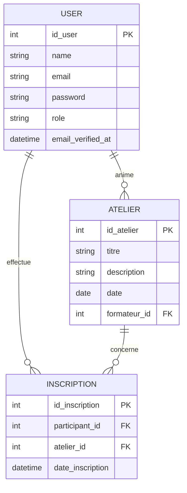

# Formation Platform

Plateforme web de gestion des formations et des ateliers, développée avec **Laravel pour le Backend** et **Angular pour le Frontend**.

---

## 1. Présentation du projet

Formation Platform est une application permettant de gérer les utilisateurs, les ateliers de formation et les accès selon le rôle de chaque utilisateur.

### Objectifs

- Centraliser la gestion des formations et des ateliers.
- Gérer les utilisateurs et leurs rôles.
- Sécuriser l'authentification.
- Permettre la gestion des ateliers à travers une API REST.
- Séparer le Backend et le Frontend pour faciliter la maintenance et l'évolution du projet.

### Rôles utilisateurs

| Rôle | Responsabilités |
|---|---|
| Admin | Gestion générale de la plateforme et des utilisateurs |
| Formateur | Consultation des ateliers qu'il anime et de leurs participants |
| Participant | Accès aux fonctionnalités destinées aux participants |

---

# 2. Technologies utilisées

## Backend

- **Laravel** : Framework PHP pour développer l'API REST.
- **PHP** : Langage de programmation côté serveur.
- **MySQL** : Système de gestion de base de données.
- **Composer** : Gestionnaire de dépendances PHP.
- **Laravel Validation** : Validation des données reçues par l'API.
- **Middleware** : Protection des routes et contrôle des accès.
- **Eloquent ORM** : Gestion des données et des relations entre les modèles.
- **Mail** : Envoi des codes OTP et des emails.

## Frontend

- **Angular** : Framework TypeScript pour développer l'interface utilisateur.
- **TypeScript** : Langage de programmation.
- **HTML5 / CSS3** : Structure et présentation.
- **Tailwind CSS 3** : Framework CSS pour le design.
- **Angular Reactive Forms** : Gestion et validation des formulaires.
- **Angular Router** : Navigation entre les pages.
- **HttpClient** : Communication avec l'API Laravel.
- **RxJS** : Gestion des opérations asynchrones.

---

# 3. Architecture générale

L'application utilise une architecture séparée en deux applications indépendantes.

```text
formation-platform/
│
├── backend/
│   ├── app/
│   ├── bootstrap/
│   ├── config/
│   ├── database/
│   ├── public/
│   ├── resources/
│   ├── routes/
│   ├── storage/
│   ├── tests/
│   ├── .env
│   └── composer.json
│
└── frontend/
    ├── src/
    │   ├── app/
    │   ├── assets/
    │   ├── environments/
    │   ├── index.html
    │   └── styles.css
    ├── angular.json
    ├── package.json
    └── tailwind.config.js
```

Le Frontend Angular communique avec le Backend Laravel à travers des requêtes HTTP au format JSON.

```text
Utilisateur
    |
    v
Angular Frontend
    |
    | HTTP / JSON
    v
Laravel REST API
    |
    v
Controllers
    |
    v
Models / Eloquent
    |
    v
MySQL Database
```

---

# 4. Installation du Backend Laravel

## 4.1. Prérequis

Installer les outils suivants :

- PHP compatible avec la version de Laravel du projet.
- Composer.
- MySQL.
- Git.

## 4.2. Accéder au dossier Backend

```bash
cd backend
```

## 4.3. Installer les dépendances

```bash
composer install
```

## 4.4. Configurer le fichier `.env`

Créer le fichier `.env` à partir du fichier d'exemple :

```powershell
Copy-Item .env.example .env
```

Configurer les informations de l'application et de la base de données :

```env
APP_NAME="Formation Platform"
APP_ENV=local
APP_KEY=
APP_DEBUG=true
APP_URL=http://127.0.0.1:8003

DB_CONNECTION=mysql
DB_HOST=127.0.0.1
DB_PORT=3306
DB_DATABASE=formation_platform
DB_USERNAME=root
DB_PASSWORD=

MAIL_MAILER=smtp
MAIL_HOST=
MAIL_PORT=
MAIL_USERNAME=
MAIL_PASSWORD=
MAIL_ENCRYPTION=
MAIL_FROM_ADDRESS=
MAIL_FROM_NAME="${APP_NAME}"
```

**Important :** remplacer les valeurs de configuration par celles de votre environnement. Ne jamais publier les mots de passe, clés API ou identifiants email dans Git.

## 4.5. Générer la clé Laravel

```bash
php artisan key:generate
```

## 4.6. Créer la base de données

Créer une base de données MySQL nommée :

```sql
CREATE DATABASE formation_platform;
```

## 4.7. Exécuter les migrations

```bash
php artisan migrate
```

Si le projet possède des seeders :

```bash
php artisan db:seed
```

Pour exécuter migrations et seeders ensemble :

```bash
php artisan migrate --seed
```

Attention : `migrate:fresh` supprime les tables existantes et leurs données. À utiliser uniquement dans un environnement de développement où la suppression des données est acceptable.

## 4.8. Démarrer le Backend

```bash
php artisan serve --host=127.0.0.1 --port=8003
```

API disponible à l'adresse :

```text
http://127.0.0.1:8003
```

---

# 5. Structure du Backend Laravel

Les principaux dossiers du Backend sont organisés comme suit :

```text
backend/
│
├── app/
│   ├── Http/
│   │   ├── Controllers/
│   │   │   └── Api/
│   │   ├── Middleware/
│   │   ├── Requests/
│   │   └── Kernel.php
│   │
│   ├── Models/
│   ├── Mail/
│   ├── Services/
│   └── Providers/
│
├── bootstrap/
│   └── app.php
│
├── config/
│   ├── app.php
│   ├── cors.php
│   ├── database.php
│   └── mail.php
│
├── database/
│   ├── migrations/
│   ├── seeders/
│   └── factories/
│
├── routes/
│   ├── api.php
│   └── web.php
│
└── storage/
    └── logs/
```

### Responsabilité des principaux composants

| Composant | Responsabilité |
|---|---|
| Controllers | Recevoir et traiter les requêtes HTTP |
| Models | Représenter les données et les relations |
| Middleware | Contrôler l'accès aux routes |
| Form Requests | Valider les données entrantes |
| Services | Centraliser la logique métier |
| Migrations | Définir la structure de la base de données |
| Seeders | Insérer des données initiales |
| Routes | Définir les endpoints de l'API |

---

# 6. Authentification et sécurité

Le Backend gère l'authentification et les accès des utilisateurs.

### 6.1. Inscription

Le processus d'inscription comprend :

1. Réception des informations de l'utilisateur.
2. Validation des champs.
3. Vérification de l'adresse email.
4. Création du compte.
5. Envoi d'un code OTP par email.
6. Vérification du code pour confirmer l'adresse email.

### 6.2. Vérification email avec OTP

Le système utilise un code OTP à six chiffres.

- Le code est envoyé par email.
- Le code possède une durée de validité de 10 minutes.
- Le code doit être vérifié avant de confirmer l'adresse email.
- Le code ne doit pas être stocké en clair dans la base de données.

### 6.3. Connexion

L'utilisateur fournit :

- Son adresse email.
- Son mot de passe.

Le Backend vérifie les informations et retourne les données nécessaires à l'authentification du Frontend.

### 6.4. Mot de passe oublié

Le processus comprend :

1. Saisie de l'adresse email.
2. Envoi d'un code OTP.
3. Vérification du code.
4. Vérification de sa validité et de son expiration.
5. Définition d'un nouveau mot de passe.

### 6.5. Gestion des rôles

Les rôles utilisés dans l'application sont :

```typescript
export type UserRole = 'admin' | 'formateur' | 'participant';
```

Les accès sont contrôlés côté Backend à l'aide de middleware et de vérifications d'autorisation.

**Important :** la protection des routes Angular ne remplace jamais la vérification des permissions côté Laravel.

---

# 7. API REST

L'API est définie dans :

```text
backend/routes/api.php
```

Les routes API utilisent le préfixe :

```text
/api
```

### Contrôleurs API

Les contrôleurs identifiés dans le projet comprennent :

- `LoginController`
- `RegisterController`
- `InscriptionController`
- `ForgotPasswordController`
- `AtelierController`

### Vérifier les routes disponibles

Pour afficher les routes réellement déclarées :

```bash
php artisan route:list --path=api
```

Pour afficher les détails d'une route :

```bash
php artisan route:list --path=api/login
```

### Exemple de requête HTTP

Connexion :

```http
POST /api/login
Content-Type: application/json
Accept: application/json
```

Exemple de corps JSON :

```json
{
    "email": "user@example.com",
    "password": "password"
}
```

Les endpoints d'inscription, de vérification OTP, de réinitialisation du mot de passe et de gestion des ateliers doivent être documentés avec leurs chemins exacts tels qu'ils apparaissent dans `routes/api.php`.

---

# 8. Configuration CORS

CORS permet au Frontend Angular d'accéder à l'API Laravel depuis une origine différente.

Fichier :

```text
backend/config/cors.php
```

Exemple de configuration locale :

```php
'paths' => ['api/*', 'sanctum/csrf-cookie'],

'allowed_methods' => ['*'],

'allowed_origins' => [
    'http://localhost:4200',
],

'allowed_origins_patterns' => [],

'allowed_headers' => ['*'],

'exposed_headers' => [],

'max_age' => 0,

'supports_credentials' => false,
```

L'origine autorisée doit correspondre à l'adresse du Frontend.

Après une modification de configuration :

```bash
php artisan config:clear
php artisan cache:clear
```

---

# 9. Installation du Frontend Angular

## 9.1. Prérequis

Installer :

- Node.js.
- npm.
- Angular CLI.

Vérifier les versions :

```bash
node -v
npm -v
ng version
```

## 9.2. Accéder au dossier Frontend

```bash
cd frontend
```

## 9.3. Installer les dépendances

```bash
npm install
```

## 9.4. Configurer l'environnement

Fichier :

```text
src/environments/environment.ts
```

Exemple :

```typescript
export const environment = {
  production: false,
  apiUrl: 'http://127.0.0.1:8003/api'
};
```

L'URL doit correspondre au port sur lequel le Backend Laravel est lancé.

## 9.5. Démarrer Angular

```bash
ng serve
```

Ou :

```bash
ng serve --open
```

Le Frontend sera accessible à :

```text
http://localhost:4200
```

---

# 10. Structure du Frontend Angular

```text
frontend/
│
├── src/
│   ├── app/
│   │   ├── components/
│   │   ├── pages/
│   │   ├── services/
│   │   ├── guards/
│   │   ├── interceptors/
│   │   ├── types/
│   │   ├── app.component.ts
│   │   ├── app.config.ts
│   │   └── app.routes.ts
│   │
│   ├── environments/
│   │   └── environment.ts
│   │
│   ├── assets/
│   └── styles.css
│
├── angular.json
├── package.json
└── tailwind.config.js
```

### Responsabilité des éléments Angular

| Élément | Responsabilité |
|---|---|
| Components | Affichage et interaction avec l'utilisateur |
| Pages | Écrans principaux de l'application |
| Services | Communication avec le Backend |
| Interfaces / Types | Définition des structures de données TypeScript |
| Guards | Protection de la navigation |
| Interceptors | Traitement centralisé des requêtes HTTP |
| Routes | Configuration de la navigation |
| Environments | Configuration des environnements |

---

# 11. Communication Angular avec Laravel

Angular utilise `HttpClient` pour communiquer avec l'API.

### 11.1. Services

Les services centralisent les appels HTTP.

Exemple :

```typescript
@Injectable({
  providedIn: 'root'
})
export class AuthService {

  private apiUrl = `${environment.apiUrl}`;

  constructor(private http: HttpClient) {}

  login(data: LoginRequest): Observable<AuthResponse> {
    return this.http.post<AuthResponse>(
      `${this.apiUrl}/login`,
      data
    );
  }
}
```

### 11.2. Interfaces TypeScript

Les interfaces permettent de structurer les données reçues et envoyées.

Exemple :

```typescript
export type UserRole = 'admin' | 'formateur' | 'participant';

export interface User {
  id: number;
  name: string;
  email: string;
  role: UserRole;
  created_at?: string;
}
```

### 11.3. HTTP Interceptor

L'interceptor permet de centraliser le traitement des requêtes HTTP.

Il peut notamment :

- Ajouter le token d'authentification aux requêtes protégées.
- Centraliser certains traitements des erreurs HTTP.
- Éviter de répéter la logique d'authentification dans chaque service.

### 11.4. Route Guards

Les Guards contrôlent l'accès aux pages Angular.

Exemples de responsabilités :

- Vérifier si l'utilisateur est connecté.
- Vérifier si l'utilisateur possède le rôle administrateur.
- Empêcher un utilisateur non authentifié d'accéder aux pages protégées.
- Rediriger les utilisateurs vers la page appropriée.

---

# 12. Formulaires Angular

Le projet utilise les Reactive Forms pour gérer les formulaires.

Avantages :

- Validation centralisée.
- Gestion des champs obligatoires.
- Contrôle des formats email et mot de passe.
- Affichage des messages d'erreur.
- Meilleure séparation entre logique métier et présentation.

Exemple :

```typescript
this.loginForm = this.fb.group({
  email: ['', [
    Validators.required,
    Validators.email
  ]],

  password: ['', [
    Validators.required
  ]]
});
```

Les formulaires peuvent être utilisés pour :

- Inscription.
- Connexion.
- Vérification OTP.
- Mot de passe oublié.
- Réinitialisation du mot de passe.
- Gestion des ateliers.

---

# 13. Tailwind CSS

Le Frontend utilise Tailwind CSS 3 pour la mise en forme.

Les classes utilitaires permettent de créer :

- Des formulaires responsives.
- Des tableaux de données.
- Des cartes.
- Des boutons.
- Des menus de navigation.
- Des interfaces adaptées aux différents écrans.

Les styles globaux sont configurés dans :

```text
src/styles.css
```

La configuration Tailwind se trouve dans :

```text
tailwind.config.js
```

---

# 14. Lancement complet du projet

Deux terminaux sont nécessaires.

### Terminal 1 — Backend Laravel

```powershell
cd backend

php artisan serve --host=127.0.0.1 --port=8003
```

Backend :

```text
http://127.0.0.1:8003
```

### Terminal 2 — Frontend Angular

```powershell
cd frontend

ng serve
```

Frontend :

```text
http://localhost:4200
```

### Vérification

- Vérifier que MySQL est démarré.
- Vérifier que Laravel fonctionne.
- Vérifier que Angular fonctionne.
- Vérifier que l'URL de l'API est correcte.
- Vérifier la configuration CORS.
- Vérifier que les paramètres SMTP sont configurés pour les emails OTP.

---

# 15. Commandes utiles

## Laravel

| Commande | Description |
|---|---|
| `composer install` | Installer les dépendances |
| `php artisan serve` | Démarrer le serveur |
| `php artisan migrate` | Exécuter les migrations |
| `php artisan migrate:status` | Vérifier l'état des migrations |
| `php artisan db:seed` | Exécuter les seeders |
| `php artisan route:list` | Afficher les routes |
| `php artisan route:clear` | Vider le cache des routes |
| `php artisan config:clear` | Vider le cache de configuration |
| `php artisan cache:clear` | Vider le cache de l'application |
| `php artisan make:controller` | Créer un contrôleur |
| `php artisan make:model` | Créer un modèle |
| `php artisan make:migration` | Créer une migration |

## Angular

| Commande | Description |
|---|---|
| `npm install` | Installer les dépendances |
| `ng serve` | Démarrer le serveur Angular |
| `ng build` | Construire l'application |
| `ng generate component` | Créer un composant |
| `ng generate service` | Créer un service |
| `ng generate guard` | Créer un Guard |
| `ng generate interceptor` | Créer un Interceptor |

---

# 16. Sécurité et bonnes pratiques

- Ne jamais stocker les mots de passe en clair.
- Ne jamais exposer les informations sensibles dans le Frontend.
- Ne jamais publier le fichier `.env`.
- Valider les données côté Backend.
- Vérifier les permissions côté Laravel.
- Utiliser des codes OTP temporaires.
- Protéger les routes nécessitant une authentification.
- Éviter de dupliquer la logique métier dans les composants Angular.
- Centraliser les appels HTTP dans les services.
- Utiliser les variables d'environnement pour les URLs et configurations.
- Utiliser HTTPS en production.

---

# 17. Dépannage

### Erreur de connexion à la base de données

Vérifier :

- Le serveur MySQL.
- Le nom de la base de données.
- Le nom d'utilisateur et le mot de passe dans `.env`.

Puis exécuter :

```bash
php artisan config:clear
```

### Erreur CORS

Vérifier :

- L'origine Angular : `http://localhost:4200`.
- Le fichier `config/cors.php`.
- Le port du Backend.
- Les en-têtes HTTP.
- Le traitement des requêtes OPTIONS.

### Les emails OTP ne sont pas envoyés

Vérifier :

- La configuration SMTP dans `.env`.
- Les identifiants email.
- Le port SMTP.
- La configuration du service de messagerie.

### Angular ne communique pas avec Laravel

Vérifier :

- `environment.ts`.
- L'adresse IP et le port du Backend.
- L'existence de la route API.
- Les erreurs dans la console du navigateur.

---

# 18. Développement et maintenance

Avant de modifier le projet :

1. Vérifier les routes existantes.
2. Vérifier les contrôleurs concernés.
3. Vérifier les modèles et les migrations.
4. Vérifier les services Angular.
5. Tester les endpoints API.
6. Vérifier les permissions et les rôles.
7. Tester les fonctionnalités après chaque modification.

---

# 19. Conclusion

Formation Platform repose sur une architecture Backend / Frontend séparée.

Laravel assure la gestion des données, la logique métier, l'authentification, la validation et la sécurité.

Angular assure l'interface utilisateur, les formulaires, la navigation et la communication avec l'API.

Cette séparation facilite la maintenance, les tests et l'évolution future de la plateforme.

---

**Projet :** Formation Platform  
**Backend :** Laravel / PHP  
**Frontend :** Angular / TypeScript  
**Base de données :** MySQL  
**CSS :** Tailwind CSS 3


## 8.1. Problème CORS rencontré pendant le développement

Pendant le développement, une erreur CORS a été rencontrée lors de la communication entre Angular et Laravel.

### Description du problème

Le Frontend Angular fonctionne sur :

```text
http://localhost:4200
```

Le Backend Laravel fonctionne sur :

```text
http://127.0.0.1:8003
```

Lors d'une tentative de connexion, le navigateur affiche une erreur similaire à :

```text
Access to XMLHttpRequest at
'http://localhost:8003/api/login'
from origin 'http://localhost:4200'
has been blocked by CORS policy.

No 'Access-Control-Allow-Origin' header is present.
```

### Cause du problème

Le navigateur effectue une requête préliminaire appelée **preflight request** avant certaines requêtes HTTP, notamment les requêtes POST utilisant des en-têtes spécifiques.

Cette requête utilise la méthode :

```http
OPTIONS /api/login
```

Le serveur doit répondre avec les en-têtes CORS appropriés, notamment :

```http
Access-Control-Allow-Origin: http://localhost:4200
Access-Control-Allow-Methods: POST
Access-Control-Allow-Headers: content-type,authorization
```

Pendant le diagnostic, la requête OPTIONS recevait une réponse HTTP `200 OK`, mais sans les en-têtes `Access-Control-Allow-*`.

### Vérifications effectuées

Les éléments suivants ont été vérifiés :

1. Le fichier `config/cors.php` contient l'origine Angular autorisée.
2. Le middleware `HandleCors` est présent dans les middlewares globaux de `app/Http/Kernel.php`.
3. Le fichier `bootstrap/app.php` associe correctement le Kernel HTTP à `App\Http\Kernel`.
4. Le fichier `public/index.php` utilise le Kernel HTTP Laravel.
5. La route `POST /api/login` existe.
6. Un test direct du middleware `HandleCors` dans Tinker génère correctement les en-têtes CORS.
7. Une requête OPTIONS réelle vers le serveur ne retourne toujours pas les en-têtes attendus.

### Commande de test CORS

Pour tester manuellement la requête OPTIONS depuis PowerShell :

```powershell
curl.exe -i -X OPTIONS "http://127.0.0.1:8003/api/login" `
-H "Origin: http://localhost:4200" `
-H "Access-Control-Request-Method: POST" `
-H "Access-Control-Request-Headers: content-type,authorization"
```

Une réponse correcte doit contenir des en-têtes similaires à :

```http
Access-Control-Allow-Origin: http://localhost:4200
Access-Control-Allow-Methods: POST
Access-Control-Allow-Headers: content-type,authorization
```

### Configuration CORS attendue

Dans `backend/config/cors.php` :

```php
'paths' => ['api/*', 'sanctum/csrf-cookie'],

'allowed_methods' => ['*'],

'allowed_origins' => [
    'http://localhost:4200',
],

'allowed_headers' => ['*'],

'supports_credentials' => false,
```

Après modification :

```bash
php artisan config:clear
php artisan cache:clear
```

### État du problème

**Problème encore en cours de diagnostic.**

La configuration CORS et le fonctionnement isolé du middleware ont été vérifiés, mais la requête OPTIONS réelle ne retourne pas encore les en-têtes CORS attendus.

La résolution définitive nécessite d'identifier pourquoi le traitement CORS n'est pas appliqué correctement lors d'une requête HTTP réelle.


# 20. Modèle Conceptuel de Données (MCD)

## 20.1. Présentation

Le Modèle Conceptuel de Données (MCD) représente les principales entités de la plateforme Formation Platform ainsi que les relations entre elles.

Il permet de comprendre l'organisation des données avant leur implémentation dans la base de données MySQL.

## 20.2. Entités principales

### USER (Utilisateur)

Représente les utilisateurs de la plateforme.

| Attribut | Description |
|---|---|
| id_user | Identifiant unique |
| name | Nom de l'utilisateur |
| email | Adresse email |
| password | Mot de passe chiffré |
| role | Rôle : admin, formateur ou participant |
| email_verified_at | Date de vérification de l'email |

### ATELIER

Représente les ateliers de formation créés et animés par les formateurs.

| Attribut | Description |
|---|---|
| id_atelier | Identifiant unique |
| titre | Titre de l'atelier |
| description | Description de l'atelier |
| date | Date de l'atelier |
| formateur_id | Identifiant du formateur responsable |

*Les noms et attributs définitifs doivent correspondre à la migration Atelier.*

### INSCRIPTION

Représente l'inscription d'un participant à un atelier.

| Attribut | Description |
|---|---|
| id_inscription | Identifiant unique |
| participant_id | Identifiant du participant |
| atelier_id | Identifiant de l'atelier |
| date_inscription | Date de l'inscription |

*Cette entité peut être une table associative entre les utilisateurs et les ateliers.*

## 20.3. Associations et cardinalités

- Un formateur peut animer plusieurs ateliers.
- Un atelier est animé par un seul formateur.
- Un participant peut s'inscrire à plusieurs ateliers.
- Un atelier peut recevoir plusieurs participants.
- Une inscription concerne un seul participant et un seul atelier.

## 20.4. Diagramme MCD



## 20.5. Passage du MCD au modèle relationnel

Le modèle relationnel correspondant à cette proposition est :

**USER**
- id_user (PK)
- name
- email
- password
- role
- email_verified_at

**ATELIER**
- id_atelier (PK)
- titre
- description
- date
- formateur_id (FK → USER.id_user)

**INSCRIPTION**
- id_inscription (PK)
- participant_id (FK → USER.id_user)
- atelier_id (FK → ATELIER.id_atelier)
- date_inscription

## 20.6. Contraintes d'intégrité

- Chaque utilisateur possède un identifiant unique.
- L'adresse email d'un utilisateur doit être unique.
- Chaque atelier doit être associé à un formateur existant.
- Chaque inscription doit référencer un participant et un atelier existants.
- Un participant ne doit pas être inscrit deux fois au même atelier.

## 20.7. Remarque

Ce MCD est une proposition conceptuelle construite à partir des fonctionnalités identifiées dans le projet. Il doit être ajusté en fonction des migrations et des relations Eloquent réellement implémentées dans Laravel.