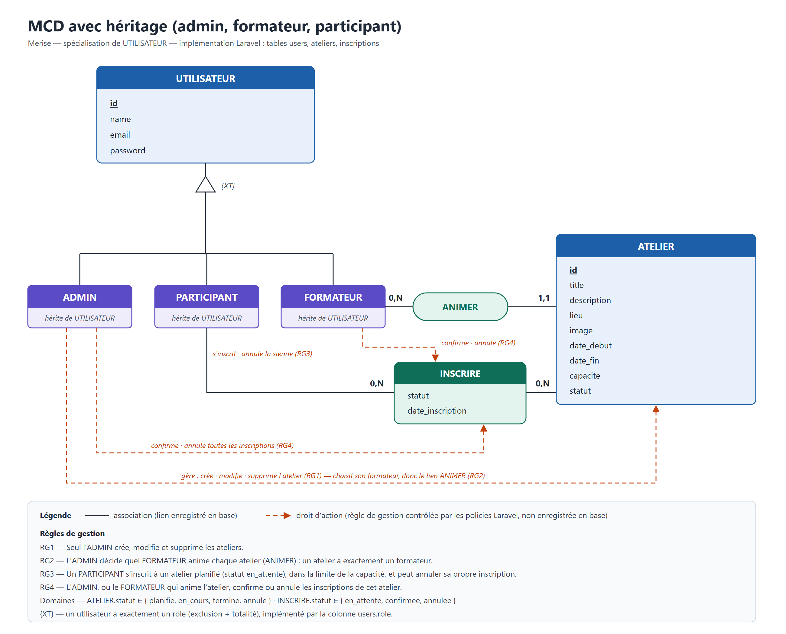

# Formation Platform

Plateforme web de gestion des formations et des ateliers, développée avec **Laravel** (Backend, API REST) et **Angular** (Frontend).

> **Note de livraison.** Une version mise à jour du code a été poussée après la date limite initiale. La résolution du problème de CORS (origine autorisée et requêtes préliminaires `OPTIONS` entre Angular et Laravel) a demandé beaucoup plus de temps que prévu et a retardé la finalisation du projet. Le problème est maintenant résolu et l'authentification fonctionne. Cette version regroupe les corrections, le MCD et la documentation complète. Le détail du problème CORS se trouve en section 8. Je suis vraiment désolé pour ce retard et je vous remercie de votre compréhension.

## Présentation

Formation Platform permet de gérer les utilisateurs, les ateliers de formation et les accès selon le rôle de chaque utilisateur.

**Objectifs**

- Centraliser la gestion des formations et des ateliers.
- Gérer les utilisateurs et leurs rôles (admin, formateur, participant).
- Sécuriser l'authentification (mot de passe, code OTP par email).
- Exposer les fonctionnalités à travers une API REST consommable par Angular et par d'autres services (par exemple une API Python).
- Séparer Backend et Frontend pour faciliter la maintenance et l'évolution.

### Rôles et fonctionnalités

| Rôle | Fonctionnalités (Backend Laravel) |
|---|---|
| Administrateur | Créer / modifier / supprimer un atelier ; associer un formateur à un atelier ; consulter les listes de participants |
| Formateur | Voir les ateliers qu'il anime ; voir les participants de ses ateliers |
| Participant | S'inscrire à un atelier et consulter ses inscriptions |

### Comptes de test (environnement de développement)

Ces comptes sont créés par le seeder `database/seeders/UserSeeder.php` :

| Rôle | Email | Mot de passe |
|---|---|---|
| Admin | `admin@example.com` | `Password123` |
| Formateur | `formateur@example.com` | `Password123` |

Le compte **participant** n'est pas créé par le seeder : il s'obtient via l'inscription dans l'application (avec vérification de l'email par code OTP).

> Ces identifiants servent uniquement au développement et aux démonstrations. Ils doivent être changés ou supprimés avant toute mise en production.

---

## 1. Modèle Conceptuel de Données (MCD)



Version PDF : [docs/MCD_ateliers.pdf](docs/MCD_ateliers.pdf)

### Lecture du MCD

- **Héritage** : `ADMIN`, `FORMATEUR` et `PARTICIPANT` héritent chacun de `UTILISATEUR` (une flèche par entité fille). La contrainte `{XT}` signifie qu'un utilisateur a **un seul rôle** (exclusion) et que **tout utilisateur a un rôle** (totalité).
- **ANIMER** (`FORMATEUR` 0,N — `ATELIER` 1,1) : un formateur anime plusieurs ateliers ; un atelier est animé par un seul formateur.
- **INSCRIRE** (`PARTICIPANT` 0,N — `ATELIER` 0,N) : un participant peut s'inscrire à plusieurs ateliers ; un atelier peut recevoir plusieurs participants. L'association porte les propriétés `statut` et `date_inscription`.
- **GERER** (`ADMIN` 0,N — `ATELIER` 1,1) : l'administrateur crée, modifie et supprime les ateliers. Dans l'implémentation actuelle, ce droit est appliqué par le contrôle du rôle `admin` ; une colonne `admin_id` dans `ateliers` peut être ajoutée pour garder la trace du créateur.

### Passage au modèle relationnel (Laravel / MySQL)

L'héritage est implémenté avec **une seule table `users`** et une colonne `role` (`admin`, `formateur`, `participant`).

**users**
- id (PK)
- name
- email (unique)
- password
- role
- email_verified_at
- email_otp_hash
- email_otp_expires_at

**ateliers**
- id (PK)
- title
- description
- lieu
- image
- date_debut
- date_fin
- capacite
- statut
- formateur_id (FK → users.id)

**inscriptions**
- id (PK)
- user_id (FK → users.id)
- atelier_id (FK → ateliers.id)
- statut
- date_inscription

### Relations Eloquent correspondantes

| Modèle | Relation | Description |
|---|---|---|
| `Atelier` | `formateur()` | Formateur qui anime l'atelier |
| `Atelier` | `inscriptions()` | Inscriptions de l'atelier |
| `Atelier` | `participants()` | Participants inscrits (via `inscriptions`) |
| `User` | `ateliersAnimes()` | Ateliers animés par un formateur |
| `User` | `inscriptions()` | Inscriptions d'un participant |
| `User` | `ateliersInscrits()` | Ateliers auxquels un participant est inscrit |

### Contraintes d'intégrité

- L'email d'un utilisateur est unique.
- Chaque atelier est associé à un formateur existant.
- Chaque inscription référence un participant et un atelier existants.
- Un participant ne peut pas être inscrit deux fois au même atelier.

---

## 2. Explication de l'architecture

L'application est composée de deux applications indépendantes qui communiquent en HTTP / JSON.

```text
Utilisateur
    |
    v
Angular Frontend  (http://localhost:4200)
    |
    | HTTP / JSON
    v
Laravel REST API  (http://127.0.0.1:8003/api)  <----  API Python (client HTTP)
    |
    v
Controllers  -->  Models / Eloquent  -->  MySQL
```

### Organisation du dépôt

```text
formation-platform/
├── backend/        Laravel (API REST)
│   ├── app/
│   │   ├── Http/Controllers/Api/   LoginController, RegisterController,
│   │   │                           InscriptionController, ForgotPasswordController,
│   │   │                           AtelierController
│   │   ├── Http/Middleware/
│   │   ├── Models/                 User, Atelier, Inscription
│   │   ├── Mail/                   Emails OTP
│   │   └── Services/
│   ├── config/cors.php
│   ├── database/                   migrations, seeders (UserSeeder), factories
│   ├── routes/api.php
│   └── .env
└── frontend/       Angular
    └── src/
        ├── app/                    components, pages, services, guards,
        │                           interceptors, types, routes
        └── environments/environment.ts
```

### Responsabilités

| Couche | Rôle |
|---|---|
| Routes (`routes/api.php`) | Définissent les endpoints de l'API (préfixe `/api`) |
| Middleware | Protègent les routes et contrôlent l'accès selon le rôle |
| Controllers | Reçoivent les requêtes HTTP et renvoient du JSON |
| Form Requests / Validation | Valident les données entrantes |
| Models (Eloquent) | Représentent les données et leurs relations |
| Services / Mail | Logique métier et envoi des codes OTP |
| Angular Services | Centralisent les appels `HttpClient` vers l'API |
| Guards / Interceptors | Protègent la navigation et ajoutent le token aux requêtes |

### Sécurité des accès

Les permissions sont **toujours vérifiées côté Laravel** (middleware et autorisations). Les Guards Angular améliorent l'expérience utilisateur mais ne remplacent jamais ces vérifications.

---

## 3. Instructions d'installation

### 3.1. Prérequis

- PHP compatible avec la version de Laravel du projet, et Composer
- MySQL
- Node.js, npm et Angular CLI
- Git

### 3.2. Backend Laravel

```bash
cd backend
composer install
```

Créer le fichier `.env` à partir de l'exemple :

```bash
cp .env.example .env          # Linux / macOS
Copy-Item .env.example .env   # PowerShell
```

Configurer l'application, la base de données et le mail :

```env
APP_NAME="Formation Platform"
APP_ENV=local
APP_DEBUG=true
APP_URL=http://127.0.0.1:8003

DB_CONNECTION=mysql
DB_HOST=127.0.0.1
DB_PORT=3306
DB_DATABASE=formation_platform
DB_USERNAME=root
DB_PASSWORD=

MAIL_MAILER=smtp
MAIL_HOST=
MAIL_PORT=
MAIL_USERNAME=
MAIL_PASSWORD=
MAIL_ENCRYPTION=
MAIL_FROM_ADDRESS=
MAIL_FROM_NAME="${APP_NAME}"
```

> Ne jamais publier le fichier `.env`, les mots de passe, les clés API ou les identifiants email dans Git.

Générer la clé, créer la base de données, puis exécuter les migrations :

```bash
php artisan key:generate
```

```sql
CREATE DATABASE formation_platform;
```

```bash
php artisan migrate
```

### 3.3. Créer les comptes admin et formateur (seeder)

```bash
php artisan db:seed --class=UserSeeder
```

Le seeder utilise `updateOrCreate` sur l'email : il peut être relancé sans créer de doublons.

```php
User::updateOrCreate(
    ['email' => $user['email']],
    $user
);
```

Pour que le rôle soit bien enregistré, le champ `role` doit exister dans la migration de `users` **et** figurer dans `$fillable` du modèle `User` :

```php
protected $fillable = [
    'name',
    'email',
    'password',
    'role',
    'email_otp_hash',
    'email_otp_expires_at',
    'email_verified_at',
];
```

> Sans `role` dans `$fillable`, Laravel ignore silencieusement cette valeur lors du `updateOrCreate`, et les comptes seront créés sans rôle.

`migrate:fresh` supprime toutes les tables et leurs données : à réserver au développement.

### 3.4. Démarrer le Backend

```bash
php artisan serve --host=127.0.0.1 --port=8003
```

API disponible sur `http://127.0.0.1:8003`.

### 3.5. Frontend Angular

```bash
cd frontend
npm install
```

Vérifier `src/environments/environment.ts` (l'URL doit correspondre au port du Backend) :

```typescript
export const environment = {
  production: false,
  apiUrl: 'http://127.0.0.1:8003/api'
};
```

Démarrer Angular :

```bash
ng serve
```

Frontend disponible sur `http://localhost:4200`.

### 3.6. Vérifications

- MySQL est démarré.
- `php artisan route:list --path=api` affiche les routes attendues.
- L'URL de l'API dans `environment.ts` est correcte.
- Les origines de `config/cors.php` correspondent au Frontend.
- Les paramètres SMTP sont renseignés pour l'envoi des codes OTP.

---

## 4. Justification des choix techniques

| Choix | Justification |
|---|---|
| **Laravel + Eloquent** | Framework complet : routes, validation, middleware, authentification et ORM intégrés. Les relations entre `User`, `Atelier` et `Inscription` s'écrivent directement dans les modèles. |
| **API REST en JSON** | Interface simple, indépendante du client : Angular, une API Python ou tout autre service peuvent la consommer de la même façon. |
| **MySQL** | Base relationnelle adaptée aux relations utilisateur / atelier / inscription, avec clés étrangères et contraintes d'intégrité. |
| **Table `users` unique avec colonne `role`** | Traduction simple de l'héritage du MCD (admin, formateur, participant) : une seule authentification, des rôles contrôlés par middleware. |
| **Table `inscriptions`** | L'association INSCRIRE (N,N) porte des propriétés (`statut`, `date_inscription`) : elle devient une table associative. |
| **Authentification par token (Sanctum)** | Adaptée à une API consommée par un Frontend séparé ou un service externe : le client envoie `Authorization: Bearer <token>`. |
| **Code OTP par email (hashé, 10 min)** | Vérifie l'adresse email et sécurise la réinitialisation du mot de passe. Le code n'est jamais stocké en clair et expire rapidement. |
| **Contrôle des rôles côté Laravel** | Seule la vérification côté serveur est fiable ; les Guards Angular ne servent qu'à la navigation. |
| **Angular + TypeScript** | Structure claire (composants, services, guards, interceptors), typage fort des données, Reactive Forms pour valider les formulaires. |
| **Tailwind CSS 3** | Mise en forme rapide et cohérente, interfaces responsives sans CSS personnalisé volumineux. |
| **Séparation Backend / Frontend** | Chaque application évolue, se teste et se déploie indépendamment. |
| **CORS configuré dans Laravel** | Autorise le navigateur à appeler l'API depuis l'origine Angular (`http://localhost:4200`). |
| **API Python comme client HTTP** | Un service Python communique avec Laravel en JSON via HTTP, sans dépendance technique entre les deux. Les requêtes serveur à serveur ne sont pas soumises à CORS. |

---

## 5. Exemple d'échange entre API Python et Laravel

Le service Python joue le rôle de **client** de l'API Laravel : il s'authentifie, récupère un token, puis appelle une route protégée.

```text
API Python                                   Laravel
    |  POST /api/login (email, password)       |
    |----------------------------------------->|
    |  200 OK  { token, user }                 |
    |<-----------------------------------------|
    |  GET /api/ateliers                       |
    |  Authorization: Bearer <token>           |
    |----------------------------------------->|
    |  200 OK  [ { atelier }, ... ]            |
    |<-----------------------------------------|
```

> Les chemins et les champs de réponse ci-dessous sont des exemples. Les endpoints réels sont ceux affichés par `php artisan route:list --path=api`.

### Code Python (bibliothèque `requests`)

```python
import requests

BASE_URL = "http://127.0.0.1:8003/api"
HEADERS = {"Accept": "application/json"}

# 1. Connexion avec le compte formateur du seeder
response = requests.post(
    f"{BASE_URL}/login",
    json={"email": "formateur@example.com", "password": "Password123"},
    headers=HEADERS,
    timeout=10,
)
response.raise_for_status()
token = response.json()["token"]

# 2. Appel d'une route protégée avec le token
auth_headers = {**HEADERS, "Authorization": f"Bearer {token}"}
ateliers = requests.get(f"{BASE_URL}/ateliers", headers=auth_headers, timeout=10)
ateliers.raise_for_status()

for atelier in ateliers.json():
    print(atelier["title"], atelier["date_debut"])
```

### Requête et réponse HTTP

Connexion :

```http
POST /api/login HTTP/1.1
Host: 127.0.0.1:8003
Content-Type: application/json
Accept: application/json

{"email": "formateur@example.com", "password": "Password123"}
```

```http
HTTP/1.1 200 OK
Content-Type: application/json

{
  "token": "1|abcdef...",
  "user": { "id": 2, "name": "Formateur", "email": "formateur@example.com", "role": "formateur" }
}
```

Route protégée :

```http
GET /api/ateliers HTTP/1.1
Host: 127.0.0.1:8003
Accept: application/json
Authorization: Bearer 1|abcdef...
```

### Codes de réponse à gérer côté Python

| Code | Signification |
|---|---|
| 200 | Succès |
| 401 | Token absent, invalide ou expiré |
| 403 | Rôle insuffisant pour cette route |
| 422 | Données invalides (erreurs de validation) |

---

## 6. Authentification et sécurité

### Inscription

1. Réception et validation des informations de l'utilisateur.
2. Création du compte.
3. Envoi d'un code OTP à six chiffres par email.
4. Vérification du code pour confirmer l'adresse email.

### Code OTP

- Valable 10 minutes.
- Stocké sous forme de hash (`email_otp_hash`), jamais en clair.
- Doit être vérifié avant de confirmer l'adresse email.

### Connexion

L'utilisateur fournit son email et son mot de passe ; le Backend vérifie les informations et renvoie les données d'authentification au client.

### Mot de passe oublié

1. Saisie de l'adresse email.
2. Envoi d'un code OTP.
3. Vérification du code et de son expiration.
4. Définition d'un nouveau mot de passe.

### Rôles

```typescript
export type UserRole = 'admin' | 'formateur' | 'participant';
```

Bonnes pratiques :

- Ne jamais stocker les mots de passe en clair.
- Ne jamais publier le fichier `.env`.
- Valider les données et vérifier les permissions côté Laravel.
- Centraliser les appels HTTP dans les services Angular.
- Utiliser HTTPS en production.

---

## 7. API REST

Les routes sont définies dans `backend/routes/api.php` avec le préfixe `/api`.

Contrôleurs : `LoginController`, `RegisterController`, `InscriptionController`, `ForgotPasswordController`, `AtelierController`.

```bash
php artisan route:list --path=api
php artisan route:list --path=api/login
```

Exemple de connexion :

```http
POST /api/login
Content-Type: application/json
Accept: application/json
```

```json
{
    "email": "user@example.com",
    "password": "password"
}
```

---

## 8. Configuration CORS

**Statut : résolu.** Les origines autorisées dans `config/cors.php` correspondent maintenant à l'adresse du Frontend, et la connexion Angular → Laravel fonctionne.

CORS permet au Frontend Angular (`http://localhost:4200`) d'appeler l'API Laravel (`http://127.0.0.1:8003`) depuis une origine différente. Fichier : `backend/config/cors.php`.

```php
'paths' => ['api/*', 'sanctum/csrf-cookie'],
'allowed_methods' => ['*'],
'allowed_origins' => [
    'http://localhost:4200',
],
'allowed_origins_patterns' => [],
'allowed_headers' => ['*'],
'exposed_headers' => [],
'max_age' => 0,
'supports_credentials' => false,
```

Après modification :

```bash
php artisan config:clear
php artisan cache:clear
```

### Historique du problème rencontré

Pendant le développement, le navigateur bloquait la connexion avec une erreur du type :

```text
Access to XMLHttpRequest at 'http://localhost:8003/api/login'
from origin 'http://localhost:4200' has been blocked by CORS policy.
No 'Access-Control-Allow-Origin' header is present.
```

Avant certaines requêtes POST, le navigateur envoie une requête préliminaire `OPTIONS /api/login` (*preflight*). Le serveur doit y répondre avec les en-têtes `Access-Control-Allow-*`.

Test manuel depuis PowerShell :

```powershell
curl.exe -i -X OPTIONS "http://127.0.0.1:8003/api/login" `
-H "Origin: http://localhost:4200" `
-H "Access-Control-Request-Method: POST" `
-H "Access-Control-Request-Headers: content-type,authorization"
```

Réponse attendue :

```http
Access-Control-Allow-Origin: http://localhost:4200
Access-Control-Allow-Methods: POST
Access-Control-Allow-Headers: content-type,authorization
```

---

## 9. Communication Angular → Laravel

- **Services** : centralisent les appels `HttpClient`.
- **Interfaces TypeScript** : structurent les données échangées.
- **Interceptor** : ajoute le token aux requêtes protégées et centralise le traitement des erreurs HTTP.
- **Guards** : vérifient que l'utilisateur est connecté et possède le bon rôle avant d'afficher une page.
- **Reactive Forms** : validation des formulaires (inscription, connexion, OTP, mot de passe oublié, gestion des ateliers).

```typescript
@Injectable({ providedIn: 'root' })
export class AuthService {
  private apiUrl = `${environment.apiUrl}`;

  constructor(private http: HttpClient) {}

  login(data: LoginRequest): Observable<AuthResponse> {
    return this.http.post<AuthResponse>(`${this.apiUrl}/login`, data);
  }
}
```

---

## 10. Lancement complet

Deux terminaux sont nécessaires.

```powershell
# Terminal 1 : Backend
cd backend
php artisan serve --host=127.0.0.1 --port=8003

# Terminal 2 : Frontend
cd frontend
ng serve
```

Backend : `http://127.0.0.1:8003` — Frontend : `http://localhost:4200`.

---

## 11. Commandes utiles

| Laravel | Description |
|---|---|
| `php artisan migrate` | Exécuter les migrations |
| `php artisan migrate:status` | État des migrations |
| `php artisan db:seed --class=UserSeeder` | Créer les comptes admin et formateur |
| `php artisan route:list` | Afficher les routes |
| `php artisan config:clear` | Vider le cache de configuration |
| `php artisan cache:clear` | Vider le cache de l'application |

| Angular | Description |
|---|---|
| `npm install` | Installer les dépendances |
| `ng serve` | Démarrer le serveur de développement |
| `ng build` | Construire l'application |

---

## 12. Dépannage

| Problème | Vérifications |
|---|---|
| Erreur de connexion à la base de données | Serveur MySQL démarré, nom de la base, identifiants dans `.env`, puis `php artisan config:clear` |
| Erreur CORS | Origine Angular dans `config/cors.php`, port du Backend, en-têtes HTTP, réponse aux requêtes `OPTIONS` |
| Emails OTP non envoyés | Configuration SMTP dans `.env`, identifiants, port, service de messagerie |
| Angular ne communique pas avec Laravel | `environment.ts`, adresse IP et port, existence de la route, console du navigateur |
| Les comptes du seeder n'ont pas de rôle | Colonne `role` dans la migration de `users` et `role` dans `$fillable` du modèle `User` |

---

**Projet :** Formation Platform — **Backend :** Laravel / PHP — **Frontend :** Angular / TypeScript — **Base de données :** MySQL — **CSS :** Tailwind CSS 3